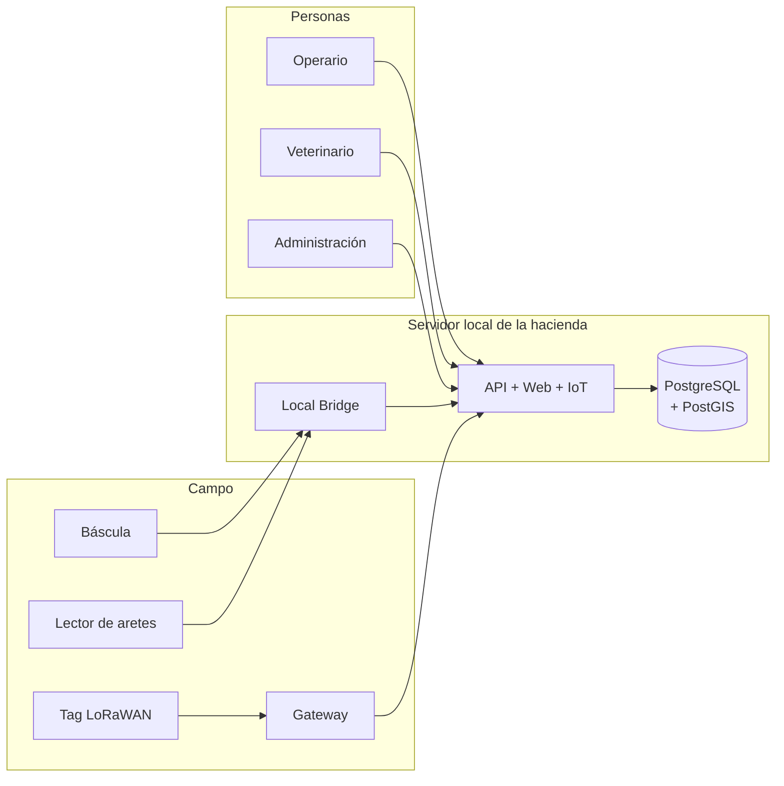

# Hacienda Ganadera — Plataforma de administración, trazabilidad y monitoreo

[](docs/01-especificacion-corregida.md)
[](docs/07-cierre-y-confirmaciones.md)
[](docs/adr/README.md)
[](LICENSE)

Plataforma empresarial para administrar una hacienda ganadera de ciclo completo: cada animal conserva una
historia **única, permanente e inalterable** desde su nacimiento o ingreso hasta su salida.

Diseñada para operar en **infraestructura local de la hacienda** (un servidor, un `docker compose up`),
preparada para despliegue híbrido o en nube, y usable desde computador, tableta y celular.

> **Estado actual: Fase 1 — plataforma base funcionando.**
> Ya se puede arrancar, iniciar sesión y operar: API con autenticación (JWT RS256 + refresh rotativo +
> MFA TOTP), RBAC con alcance, auditoría encadenada verificable, web operativa, PWA instalable con pantalla
> offline y 45 pruebas automatizadas en verde. Los módulos de animales y pesajes llegan en las fases 2–4.

---

## Por qué este repositorio empieza por documentos y no por pantallas

La especificación original era extensa y correcta en alcance, pero tenía **9 ambigüedades bloqueantes** que,
de no resolverse antes de la primera línea de código, garantizaban retrabajo estructural: qué significa
"inmutable", quién gana un conflicto offline, cómo se detecta un peso estable, cómo se autentica un puente de
hardware, cómo se evita inventar una posición GPS.

El resultado de esa revisión está en [`docs/00`](docs/00-validacion-de-la-especificacion.md): 26 hallazgos, cada
uno con impacto y decisión. La versión corregida de la especificación es [`docs/01`](docs/01-especificacion-corregida.md).

---

## Reglas inviolables (resumen)

El sistema no inventa datos. Nunca. Doce invariantes gobiernan el diseño; estos son los que más consecuencias
tienen:

| ID | Regla |
|---|---|
| `INV-03` | No se asume que LoRaWAN provee GPS. Sin fix GNSS no hay coordenada. |
| `INV-04` | No se inventan posiciones: la base de datos rechaza lat/lon si el tipo de ubicación no lo justifica. |
| `INV-05` | No se sobrescriben datos históricos: todo se corrige con eventos compensatorios. |
| `INV-06` | La auditoría es verificable: cadena de hashes SHA-256 + verificación automática. |
| `INV-08` | Todo dato simulado se identifica como simulado, en la API y en la interfaz. |
| `INV-09` | Una integración física no se declara validada sin evidencia: cada dispositivo tiene estado `declared`, `simulated`, `lab_verified` o `field_verified`. |

Lista completa en [`docs/01` §3](docs/01-especificacion-corregida.md).

---

## Puesta en marcha

### Opción A — Docker (recomendado en la hacienda)

```bash
cp .env.example .env                # complete las contraseñas
node scripts/dev/generate-keys.mjs  # claves RS256 en secrets/ (ignoradas por Git)

docker compose up -d postgres redis minio proxy
docker compose --profile app up -d --build

# Primera vez: catálogos, roles y usuario administrador
docker compose exec api env RUN_SEED=true node /app/scripts/dev/lib/seed.mjs
```

- Web: `http://localhost` (el proxy enruta a la web y a la API)
- API y Swagger: `http://localhost/api/docs`
- El usuario administrador y su contraseña los imprime el seed una sola vez.

### Opción B — sin Docker (desarrollo en cualquier equipo)

```bash
pnpm install

# 1. Base de datos embebida (descarga un PostgreSQL temporal, sin instalar nada)
pnpm db:local --persist        # en otra terminal: aplica migraciones y siembra datos

# 2. API + web
pnpm dev
```

- Web: `http://127.0.0.1:3000`
- API: `http://127.0.0.1:3100` · Swagger en `/api/docs`

### Verificación

```bash
pnpm verify        # documentación, secretos, lint, tipos, unitarias, integración y OpenAPI
pnpm test:e2e      # prueba de humo contra los servicios en marcha
pnpm audit:verify  # integridad de la cadena de auditoría
```

## Mapa de la documentación

```text
docs/
├── 00-validacion-de-la-especificacion.md   ← qué falla en la especificación original
├── 01-especificacion-corregida.md          ← el contrato (invariantes, RF, RNF, fases, DoD)
├── 02-arquitectura.md                      ← C4, flujos, frontend, backend, PostGIS, IoT
├── 03-modelo-de-datos.md                   ← 68 tablas, DDL de referencia, integridad en la base
├── 04-estrategia-de-pruebas.md             ← pirámide, HIL, simuladores, SYNC-01…12, carga
├── 05-requisitos-hardware-y-riesgos.md     ← servidor, básculas, gateways, 30 riesgos
├── 06-estructura-y-convenciones.md         ← ramas, commits, CI, releases
├── 07-cierre-y-confirmaciones.md           ← qué confirmar antes de la Fase 1
├── adr/                                    ← 10 decisiones arquitectónicas
├── diagrams/                               ← fuentes Mermaid
├── manuals/ · runbooks/ · api/ · tests/load/
```

Empieza por [`docs/README.md`](docs/README.md) si es tu primera vez aquí.

---

## Alcance en una imagen



Módulos: identificación y genealogía · pesajes y crecimiento · salud y reproducción · nacimientos y levante ·
alimentación · potreros y movimientos · inventario · compras y ventas · finanzas · documentos · auditoría ·
alertas · reportes · IoT/LoRaWAN · mapas y geocercas · usuarios y seguridad · PWA offline.

---

## Roadmap

Doce fases, cada una con criterios de terminado medibles ([`docs/01` §17](docs/01-especificacion-corregida.md)).
Detalle en [`ROADMAP.md`](ROADMAP.md).

| Fase | Alcance | Estado |
|---|---|---|
| **F0** | Validación, especificación v2, arquitectura, repositorio y CI | ✅ entregado |
| **F1** | Docker, PostgreSQL, backend, seguridad, autenticación, RBAC y auditoría encadenada | ✅ entregado |
| **F2** | Animales, identificación, usuarios, roles e inventario | ⏳ siguiente |
| **F3** | Báscula, códigos de barras y Local Bridge | pendiente |
| **F4** | Pesajes, crecimiento y reportes | pendiente |
| **F5** | Veterinaria y salud | pendiente |
| **F6** | Reproducción, nacimientos y genética | pendiente |
| **F7** | Alimentación, potreros y movimientos | pendiente |
| **F8** | Compras, ventas y finanzas | pendiente |
| **F9** | LoRaWAN, tags y gateways | pendiente |
| **F10** | GPS/GNSS, mapas, PostGIS y geocercas | pendiente |
| **F11** | Dashboard, notificaciones, reportes y analítica | pendiente |
| **F12** | Offline/PWA, sincronización, hardening, carga y despliegue | pendiente |

---

## Stack previsto

| Capa | Tecnología |
|---|---|
| Frontend | Next.js + React + TypeScript + Tailwind + shadcn/ui, PWA con IndexedDB |
| Backend | NestJS + TypeScript, REST/OpenAPI, WebSocket, colas BullMQ |
| Datos | PostgreSQL 16 + PostGIS 3.4, migraciones SQL versionadas, Prisma para dominio |
| IoT | LoRaWAN (ChirpStack local o The Things Stack), MQTT, webhooks, servicio de integración propio |
| Hardware | Local Bridge (Node) con adaptadores de báscula, lectores HID, mTLS |
| Mapas | OpenStreetMap con Leaflet o MapLibre (decisión por prueba, [ADR-0009](docs/adr/ADR-0009-libreria-de-mapas.md)) |
| Infraestructura | Docker Compose, Caddy, MinIO, Redis, Prometheus/Grafana |
| Calidad | Vitest, Playwright, k6, Testcontainers, GitHub Actions |

---

## Qué NO es este proyecto

- No es un CRUD con pantallas bonitas: el criterio de terminación exige persistencia, integraciones simuladas
  con adaptador real, mapas, alertas, reportes, offline, Docker, pruebas y documentación funcionando.
- No es un producto multi-tenant SaaS ([ADR-0006](docs/adr/ADR-0006-tenancy-mono-tenant.md)).
- No incluye contabilidad formal, nómina, facturación electrónica ni certificación oficial: el sistema
  **prepara** los datos y **exporta**; la certificación es un proceso externo.
- No afirma tener integraciones físicas validadas. No hay hardware conectado en esta etapa; hay contrato,
  simuladores y estados de integración declarados.

---

## Cómo trabajar en este repositorio

```bash
git clone https://github.com/MrCastilloF/Hacienda_Ganadera.git
cd Hacienda_Ganadera

# Validaciones del repositorio (sin dependencias, funciona hoy)
node scripts/ci/check-docs.mjs
node scripts/ci/check-secrets.mjs
docker compose config -q
```

Cuando exista código (Fase 1):

```bash
pnpm install
pnpm dev            # levanta la plataforma
pnpm verify         # lint + tipos + pruebas + docs + secretos
```

Reglas de contribución: [`CONTRIBUTING.md`](CONTRIBUTING.md). Convención de ramas y commits:
[`docs/06`](docs/06-estructura-y-convenciones.md).

---

## Seguridad y datos

- No se aceptan credenciales en el repositorio: el CI las busca y bloquea el merge.
- Las claves de dispositivos LoRaWAN viven en un gestor de secretos, nunca en la base ni en Git
  ([ADR-0007](docs/adr/ADR-0007-gestion-secretos-iot.md)).
- Los datos personales se minimizan y se protegen con cifrado por sujeto
  ([`docs/01` §14](docs/01-especificacion-corregida.md)).

Reporte de vulnerabilidades: [`SECURITY.md`](SECURITY.md).

---

## Licencia

Propietaria — todos los derechos reservados. Ver [`LICENSE`](LICENSE). El titular y la licencia definitiva
están pendientes de confirmación (punto `C-05` en [`docs/07`](docs/07-cierre-y-confirmaciones.md)).
