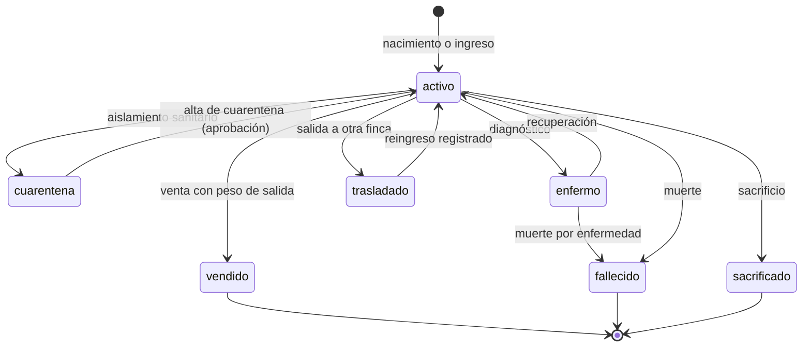

# Especificación corregida y completada — Plataforma Hacienda Ganadera

**Documento:** `docs/01-especificacion-corregida.md`
**Versión:** 2.0.0
**Fecha:** 2026-11-10
**Base:** `PROMPT MAESTRO — DESARROLLO DE PLATAFORMA WEB INTEGRAL…` (v1, §1–§49)
**Cambios respecto a v1:** ver §19 (matriz de trazabilidad) y `docs/00-validacion-de-la-especificacion.md`
**Estado:** propuesta para aprobación — base contractual de la Fase 1

---

## 0. Cómo se lee este documento

Este documento **no reemplaza el alcance de la v1: lo hace ejecutable**. Todo requisito de la v1 está
presente; lo que cambia es que cada uno tiene un identificador, un criterio de aceptación y, cuando
aplicaba, una decisión que elimina la ambigüedad.

Convención normativa (RFC 2119):

- **DEBE / NO DEBE** — obligatorio. Su incumplimiento es un defecto, no una preferencia.
- **DEBERÍA** — recomendado; desviarse exige un ADR.
- **PUEDE** — opcional.

Identificadores:

| Prefijo | Significado | Ejemplo |
|---|---|---|
| `INV` | Invariante del sistema (no admite excepción) | `INV-03` |
| `RF-<módulo>-<n>` | Requisito funcional | `RF-PES-04` |
| `RNF-<área>-<n>` | Requisito no funcional medible | `RNF-REN-02` |
| `OPEN-<n>` | Pregunta abierta pendiente de confirmación | `OPEN-01` |
| `F<n>` | Fase de implementación | `F3` |

---

## 1. Alcance

Plataforma empresarial para administrar, trazar y monitorear una hacienda ganadera de ciclo completo.
Opera en **infraestructura local de la hacienda**, es desplegable en nube o modo híbrido, y es usable
desde computador, tableta y celular.

Cubre el ciclo de vida del animal desde nacimiento o ingreso hasta venta, traslado, sacrificio, muerte o
salida, con historia individual permanente e inalterable.

### 1.1 Dentro de alcance

Módulos de la v1 §7–§35 completos: identificación y genealogía, pesajes y crecimiento, salud y
reproducción, nacimientos y levante, alimentación, potreros y movimientos, inventario, compras, ventas y
finanzas, documentos, auditoría, alertas, reportes, IoT (LoRaWAN), geolocalización y mapas, usuarios y
seguridad, configuración de hacienda, PWA offline, Local Bridge y adaptadores de báscula.

### 1.2 Fuera de alcance (explícito, para evitar supuestos)

| Fuera de alcance | Razón |
|---|---|
| Contabilidad formal / estados financieros / impuestos / DIAN | El sistema es operativo; exporta a contabilidad externa (§5.8). |
| Nómina y gestión de personal | Solo se registra el responsable de la operación y su costo. |
| Trazabilidad oficial ante autoridad sanitaria (certificación ICA) | Se preparan los datos; la certificación es un proceso externo. |
| Multimoneda y conversión con tasa histórica | Una moneda activa por instalación (COP por defecto). |
| Multi-tenant SaaS (varios propietarios aislados por inquilino) | Mono-tenant con N fincas; `tenant_id` reservado (ADR-0006). |
| App móvil nativa (iOS/Android) | PWA; se reevalúa si el hardware lo exige. |
| Reconocimiento de imágenes, visión artificial, predicción con ML | Fuera del alcance de las 12 fases. |
| Facturación electrónica | Fuera de alcance. |

---

## 2. Glosario

| Término | Definición en este sistema |
|---|---|
| **Animal** | Unidad trazable con identificador único e historia permanente. |
| **Finca** | Predio (hacienda) del propietario. Una instalación puede tener varias. |
| **Potrero** | Subdivisión de la finca con límites geográficos, capacidad y estado de ocupación. |
| **Lote** | Agrupación operativa de animales (no geográfica necesariamente). |
| **Evento de dominio** | Hecho ocurrido en el negocio, inmutable, con autor, tiempo y payload. |
| **Pesaje** | Evento de medición de peso, con dispositivo, responsable y contexto. |
| **GDP** | Ganancia diaria de peso = (peso actual − peso anterior) / días transcurridos. |
| **HLC** | Hybrid Logical Clock: reloj lógico híbrido para ordenar eventos entre dispositivos. |
| **Idempotencia** | Propiedad por la cual repetir una operación no produce un efecto nuevo. |
| **LWW** | Last-Write-Wins: gana el último por HLC; el valor perdedor se conserva en el evento. |
| **Local Bridge** | Agente instalado en el PC de pesaje que habla con la báscula y el ERP. |
| **DevEUI** | Identificador único de un dispositivo LoRaWAN. |
| **Última ubicación conocida** | Última posición válida recibida, con su antigüedad explícita. |
| **Ubicación estimada** | Posición inferida con método y error declarados; nunca es un GPS. |
| **Dato simulado** | Dato producido por un simulador; DEBE estar marcado como tal en API y UI. |
| **Anulación** | Reemplazo lógico de un registro por un evento que lo deja sin efecto; no lo borra. |

---

## 3. Reglas inviolables

Estas reglas provienen de la v1 §46 y se elevan a **restricciones del sistema**, no a buenas prácticas.
Cada una tiene un mecanismo de cumplimiento verificable.

| ID | Regla | Mecanismo de cumplimiento |
|---|---|---|
| **INV-01** | No se inventan capacidades del hardware. | Todo campo de capacidad (`has_gnss`, `has_accelerometer`, `protocol_id`) es dato del dispositivo, no inferencia. Validación en API y en BD. |
| **INV-02** | No se asume un protocolo de báscula no especificado. | El protocolo es una fila de catálogo con adaptador registrado; sin adaptador, la báscula queda en estado `unsupported` y la UI lo dice. |
| **INV-03** | No se asume que LoRaWAN provee GPS. | `location_type ∈ {GNSS, ESTIMATED, GATEWAY_COVERAGE, ADMINISTRATIVE, NONE}`; `GNSS` exige `gnss_fix = true` y `satellites > 0`. Sin fix no hay coordenada. |
| **INV-04** | No se inventan posiciones geográficas. | Restricción `CHECK` que prohíbe lat/lon cuando `location_type ∉ {GNSS, ESTIMATED}`; `ESTIMATED` exige `accuracy_m` y `method`. |
| **INV-05** | No se sobrescriben datos históricos. | Tablas append-only + triggers; corrección por evento compensatorio. |
| **INV-06** | La auditoría es verificable. | Cadena de hashes SHA-256 + job de verificación + endpoint de comprobación. |
| **INV-07** | Las operaciones críticas no se eliminan sin trazabilidad. | No existe `DELETE` físico en entidades críticas; permiso `anular` con motivo obligatorio. |
| **INV-08** | Los datos simulados se identifican como simulados. | `origin ∈ {FIELD, SIMULATOR, IMPORT, MANUAL}` obligatorio en pesajes y telemetría; la UI muestra banda de advertencia. |
| **INV-09** | No se afirma que una integración física fue validada sin acceso al hardware. | Estado de integración `declared / simulated / lab_verified / field_verified` por dispositivo y marca; solo `field_verified` habilita el texto "validado en campo". |
| **INV-10** | No se entregan botones sin lógica, endpoints ficticios ni datos hardcodeados. | Revisión de PR con checklist; pruebas E2E cubren las acciones de UI. |
| **INV-11** | No se almacenan secretos en el código fuente. | `.env` fuera del repositorio, secret scanning en CI, gestor de secretos para claves LoRaWAN y certificados. |
| **INV-12** | Ningún módulo se elimina para simplificar el desarrollo. | El alcance se controla por fase (§18), no por recorte silencioso. |

---

## 4. Actores, roles y permisos

### 4.1 Roles iniciales (v1 §6, conservados)

Superadministrador · Administrador de hacienda · Veterinario · Mayordomo · Operario · Responsable de
báscula · Contador · Usuario de consulta.

### 4.2 Dimensiones de permiso (v1 §6, conservadas y precisadas)

`consultar`, `crear`, `modificar`, `anular` (reemplaza a "eliminar", ver `INV-07`), `aprobar`,
`exportar`.

Adicionales necesarios para que el modelo sea coherente:

| Permiso | Motivo |
|---|---|
| `resolver_conflicto` | Solo quien puede decidir sobre datos offline en conflicto. |
| `administrar_dispositivos` | Enrolar/retirar tags, gateways y básculas. |
| `ver_datos_personales` | Acceso a PII de terceros (minimización, §14.6). |
| `cerrar_periodo` | Cierre contable-operativo del periodo. |

### 4.3 Regla de composición

Un permiso es la tupla `(módulo, operación, alcance)`, donde `alcance ∈ {global, finca, lote, propio}`.
`RF-USU-03`: el sistema DEBE evaluar el alcance en el servidor; el ocultamiento en la UI es cosmético y no
sustituye la autorización.

### 4.4 Requisitos

- **RF-USU-01** Login, logout, recuperación de contraseña por correo con token de un uso y caducidad.
- **RF-USU-02** Administración de usuarios: alta, edición, baja lógica, desbloqueo, restablecimiento.
- **RF-USU-03** RBAC con permisos por módulo, operación y alcance, evaluados en backend.
- **RF-USU-04** Primer factor: contraseña (Argon2id). Segundo factor TOTP opcional por rol; **obligatorio**
  para `superadmin` y `administrador` (§14.2).
- **RF-USU-05** Sesiones: access token corto + refresh rotativo con detección de reutilización.
- **RF-USU-06** Registro de intentos fallidos con bloqueo progresivo configurable (por defecto 5 intentos /
  15 min).
- **RF-USU-07** Auditoría de toda operación crítica (§11).

---

## 5. Requisitos funcionales por módulo

### 5.1 Identificación y ficha del animal (v1 §7)

- **RF-ANI-01** Ficha única por animal con: ID interno, número de arete, código de barras, RFID opcional,
  nombre, fotografía, identificación oficial, raza, cruce racial, color, características particulares.
- **RF-ANI-02** Información biológica: fecha de nacimiento, sexo, peso de nacimiento, edad calculada,
  estado productivo, condición corporal (escala 1–5, configuración `AMB-05`), procedencia, madre, padre,
  tipo de nacimiento, observaciones.
- **RF-ANI-03** Ubicación administrativa: finca, potrero, lote, corral. **Ubicación geográfica**: última
  posición válida con tipo, método, precisión y antigüedad.
- **RF-ANI-04** Estado del animal según la máquina de estados (§7).
- **RF-ANI-05** Búsqueda por arete, código de barras, RFID, nombre y buscador libre, con lectura de
  escáner en la misma caja de búsqueda.
- **RF-ANI-06** La ficha organiza los historiales en pestañas: resumen, identificación, pesajes,
  crecimiento, salud, reproducción, genealogía, alimentación, movimientos, documentos, ubicación/IoT,
  auditoría.
- **RF-ANI-07** Ningún animal se elimina; se le asigna estado terminal (§7).
- **RF-ANI-08** Unicidad: `arete` único por finca, `codigo_barras` único global (§16, numeración `HAL-12`).
- **RF-ANI-09** Prohibida la reutilización de identificadores de animales retirados.

### 5.2 Identificación física y numeración (nuevo — `HAL-12`)

- **RF-ANI-10** Esquema de numeración configurable por finca: `prefijo + consecutivo + dígito de
  verificación`.
- **RF-ANI-11** Un identificador retirado (arete cortado, RFID sustituido) conserva historial y queda en
  estado `retired`; no vuelve a asignarse.
- **RF-ANI-12** Si el código de barras impreso no coincide con el arete, el sistema DEBE rechazar el
  registro y explicar la discrepancia.

### 5.3 Pesajes y crecimiento (v1 §8, §10)

- **RF-PES-01** Flujo de pesaje: escaneo → identificación → ficha → recepción del peso → detección de
  estabilidad → confirmación → almacenamiento → actualización del historial.
- **RF-PES-02** El registro guarda: fecha, hora, peso, edad al pesaje, responsable, tipo de pesaje
  (nacimiento, destete, control, salida, entrada, otro), observaciones, báscula, ubicación disponible,
  origen (`FIELD`/`SIMULATOR`), dispositivo y muestra cruda de la trama cuando exista.
- **RF-PES-03** Detección de peso estable con parámetros por báscula (§13.2).
- **RF-PES-04** Cálculos: peso actual, anterior, diferencia, ganancia/pérdida, GDP diaria y mensual, peso
  promedio por lote, curva de crecimiento.
- **RF-PES-05** Comparaciones: animal vs animal, raza, lote, periodo.
- **RF-PES-06** Un pesaje no se edita ni se borra: se anula con motivo y se registra uno nuevo.
- **RF-PES-07** Deduplicación: mismo animal + mismo dispositivo + ventana ≤ 60 s (configurable) ⇒
  `duplicate_of`, no nuevo evento (`HAL-23`).
- **RF-PES-08** Alertas de variación anómala: pérdida > umbral configurable (por defecto 8 % del peso
  anterior) y GDP negativa en dos pesajes consecutivos.
- **RF-PES-09** Si `origen = SIMULATOR`, la UI y la exportación DEBEN marcarlo (`INV-08`).

### 5.4 Salud y veterinaria (v1 §11)

- **RF-SAL-01** Historia clínica individual con vacunas: vacuna, enfermedad objetivo, fecha, dosis, lote,
  laboratorio, vía, próxima aplicación, veterinario, observaciones.
- **RF-SAL-02** Enfermedades y tratamientos: fecha, síntomas, diagnóstico, tratamiento, medicamento, dosis,
  inicio, finalización, responsable, resultado, costo.
- **RF-SAL-03** Registros de desparasitación, vitaminización, suplementación, control de ectoparásitos,
  cirugías, lesiones, prevención, exámenes y certificados.
- **RF-SAL-04** Alertas sanitarias por próxima aplicación vencida o próxima (ventana configurable).
- **RF-SAL-05** Periodo de retiro de medicamentos: si un animal tratado con retiro activo se registra para
  venta o sacrificio, el sistema DEBE advertir y exigir confirmación explícita.
- **RF-SAL-06** Cuarentena: alta y baja con motivo; mientras esté en cuarentena no puede moverse a potrero
  común sin aprobación (§7).

### 5.5 Reproducción, nacimientos y genética (v1 §12, §13, §19)

- **RF-REP-01** Registro de montas e inseminaciones: hembra, macho/toro o pajilla, fecha, tipo, responsable.
- **RF-REP-02** Diagnóstico de preñez: fecha, resultado, método, veterinario; cálculo de fecha probable de
  parto con parámetro de gestación (por defecto 283 días, configurable).
- **RF-REP-03** Parto: fecha/hora, tipo (normal, distócico, asistido), crías, aborto. Al registrar un
  nacimiento el sistema DEBE crear el animal, generar ID, asignar arete, registrar sexo y peso,
  asociar madre y padre, adjuntar fotografía (opcional) y actualizar la historia reproductiva de la madre.
- **RF-REP-04** Indicadores: tasa de preñez, natalidad, intervalo entre partos, días abiertos, fertilidad,
  crías por vaca, indicadores de reproductores.
- **RF-REP-05** Genealogía: padre, madre, abuelos, descendientes, raza, porcentaje racial, características
  genéticas.
- **RF-REP-06** Validaciones genealógicas: un animal no puede ser su propio ancestro; no puede ser padre y
  madre a la vez; no se admiten ciclos; la fecha de nacimiento del hijo no puede ser anterior a la del
  padre/madre. Violarlas es un error de validación, no un aviso.
- **RF-REP-07** Levante: lactancia, destete, peso al destete, edad al destete, desarrollo, mortalidad.
- **RF-REP-08** Celos: registro con fecha, intensidad y observaciones.

### 5.6 Alimentación, potreros y movimientos (v1 §14, §15)

- **RF-ALI-01** Inventario de insumos: concentrados, sales, suplementos, pastos, forrajes, silos.
- **RF-ALI-02** Consumos con cantidad, costo, proveedor, fecha y responsable.
- **RF-ALI-03** Planes nutricionales por edad, peso, categoría, etapa productiva, potrero y lote.
- **RF-ALI-04** Costo por animal, por lote y por periodo.
- **RF-POT-01** Potreros con nombre, código, área (calculada o dibujada), tipo de pasto, capacidad, estado
  (disponible, ocupado, descanso, mantenimiento), ocupación, cantidad de animales, observaciones.
- **RF-POT-02** Historia de movimientos entre potreros con fecha, motivo y responsable.
- **RF-POT-03** Alerta por sobrecarga cuando la ocupación supera la capacidad configurada (con tolerancia).
- **RF-POT-04** Movimientos con intervalos solapados en el mismo animal ⇒ conflicto para resolución humana
  (§10.5).
- **RF-POT-05** El traslado a otro potrero DEBE registrarse como evento; cambiar el campo en la ficha sin
  evento es un defecto.

### 5.7 Inventario, compras y ventas (v1 §16, §17)

- **RF-INV-01** Clasificación automática del hato: machos, hembras, terneros, terneras, novillas, novillos,
  vacas, toros, reproductores, engorde, cuarentena (categoría derivada, `AMB-07`).
- **RF-INV-02** Movimientos auditados: compras, nacimientos, ventas, muertes, traslados, sacrificios,
  ajustes.
- **RF-INV-03** Todo movimiento genera evento de dominio con autor y causa.
- **RF-INV-04** Conteo de inventario por finca, potrero, lote, categoría y estado, con fecha de corte.
- **RF-COM-01** Compra: proveedor, fecha, animal(es), peso, precio/kg, total, transporte, otros costos,
  documentos.
- **RF-COM-02** La compra DEBE generar el alta del animal o la vinculación a un animal existente.
- **RF-VEN-01** Venta: cliente, fecha, animal o lote, peso, precio/kg, total, gastos, utilidad, soportes.
- **RF-VEN-02** La venta DEBE cambiar el estado del animal a `vendido` y cerrar su trazabilidad de salida
  (peso de salida obligatorio).
- **RF-VEN-03** Verificación de retiro de medicamentos activo antes de autorizar la venta (`RF-SAL-05`).
- **RF-VEN-04** Trazabilidad completa desde adquisición/nacimiento hasta salida, consultable en la ficha.
- **RF-VEN-05** Venta prohibida en modo offline (§10.2).

### 5.8 Finanzas (v1 §18) — alcance contable definido (`HAL-09`)

- **RF-FIN-01** Registro de gastos: veterinaria, alimentación, mano de obra, mantenimiento, transporte,
  animales, insumos, vacunas, medicamentos, otros.
- **RF-FIN-02** Registro de ingresos por venta y otros conceptos.
- **RF-FIN-03** Flujo de caja por periodo con filtros por finca, centro de costo y categoría.
- **RF-FIN-04** Costeo **directo operativo**: cada gasto puede imputarse a animal, lote, potrero o finca.
  Los costos indirectos se prorratean con una regla explícita configurable (`allocation_rule`), nunca
  implícita.
- **RF-FIN-05** Rentabilidad por animal y por lote = ingresos imputados − costos directos imputados.
- **RF-FIN-06** Costo de producción, costo/kg, costo de mantenimiento y utilidad, todos con la fórmula
  visible en la UI (no cajas negras).
- **RF-FIN-07** El sistema NO calcula impuestos ni estados financieros; exporta movimientos para
  contabilidad externa.
- **RF-FIN-08** Cierre de periodo con bloqueo de asientos anteriores (`cerrar_periodo`), reversible solo por
  `superadmin` con auditoría.

### 5.9 Documentos, reportes y documentos generados (v1 §34, §40)

- **RF-DOC-01** Adjuntar fotografías, certificados, facturas, compras, ventas, laboratorios, historia
  veterinaria y movilización, siempre vinculados a su entidad.
- **RF-DOC-02** Cada documento guarda: entidad, entidad_id, tipo, nombre original, MIME real, tamaño,
  checksum SHA-256, autor, fecha, visibilidad.
- **RF-DOC-03** Validación de MIME real por firma de archivo, límite de tamaño configurable, antivirus
  (ClamAV) y URL prefirmada de corta duración (§14.4).
- **RF-DOC-04** Los documentos no se borran: se marcan `retired` con motivo y auditoría.
- **RF-REP-01** Reportes con filtros por fecha, animal, raza, sexo, categoría, potrero, lote, estado y
  responsable.
- **RF-REP-02** Exportación a Excel (XLSX) y PDF.
- **RF-REP-03** Exportaciones > 5.000 filas se procesan en cola y se notifican al usuario al terminar
  (`HAL-16`).
- **RF-REP-04** Plantillas de exportación versionadas en el repositorio; el PDF incluye finca, filtros
  aplicados, usuario y fecha de generación.

### 5.10 Unidades y moneda (nuevo — `HAL-22`)

- **RF-CFG-01** Unidad canónica de peso: **kg** (almacenamiento y API). Presentación configurable por
  usuario: kg, arroba (1 @ = 12,5 kg), libra (1 lb = 0,45359237 kg), con el factor versionado.
- **RF-CFG-02** Moneda activa por instalación (COP por defecto) con formato y decimales configurables.
- **RF-CFG-03** Toda conversión se hace en el borde (UI/exportación); la base nunca guarda arrobas.
- **RF-CFG-04** El precio puede pactarse por kg o por arroba; el sistema guarda `price_basis` explícito y
  el total calculado con la base declarada.

### 5.11 Configuración de hacienda (v1 §35)

- **RF-CFG-05** Configurar: nombre, logo, propietario, identificación tributaria, ubicación, moneda,
  unidades, razas, categorías, potreros, alertas, tipos de evento y dispositivos.
- **RF-CFG-06** Valores iniciales: peso en kg, moneda COP. Todo configurable.
- **RF-CFG-07** Configuración versionada: todo cambio de parámetro queda auditado con valor anterior y
  nuevo.

---

## 6. Requisitos no funcionales medibles (`HAL-07`)

### 6.1 Rendimiento

| ID | Requisito | Verificación |
|---|---|---|
| **RNF-REN-01** | p95 de API REST < 400 ms para lecturas simples; < 1.200 ms para reportes agregados de un mes. | Prueba de carga k6 en CI nocturno. |
| **RNF-REN-02** | El mapa carga 2.000 animales + 50 potreros + 20 gateways en < 2 s en red local. | Prueba de rendimiento de UI con datos sembrados. |
| **RNF-REN-03** | Ingesta IoT: 50 msg/s sostenidos y 200 msg/s de pico sin pérdida (buffer de cola). | Simulador LoRaWAN de `RNF-PRU-04`. |
| **RNF-REN-04** | Pantalla de pesaje interactiva en < 200 ms tras lectura del escáner. | Medición E2E. |
| **RNF-REN-05** | Cálculo de GDP y curva de crecimiento de un animal (10 años de historia) < 300 ms. | Prueba de integración. |

### 6.2 Disponibilidad y continuidad

| ID | Requisito |
|---|---|
| **RNF-DIS-01** | Disponibilidad objetivo 99,5 % mensual en operación local (≈ 3,6 h de caída al mes). |
| **RNF-DIS-02** | RPO ≤ 15 min; RTO ≤ 4 h. |
| **RNF-DIS-03** | La operación de pesaje continúa sin servidor (Local Bridge + cola local). |
| **RNF-DIS-04** | Reinicio automático de contenedores y arranque del servidor sin intervención manual documentada. |

### 6.3 Escalabilidad

| ID | Requisito |
|---|---|
| **RNF-ESC-01** | Diseño base: > 2.000 animales, > 2.000 tags, varios gateways, históricos de posiciones. |
| **RNF-ESC-02** | Crecimiento objetivo: 5.000 dispositivos sin cambio de arquitectura (solo recursos y tuning). |
| **RNF-ESC-03** | Toda consulta de listado DEBE estar paginada (por defecto 25, máximo 200). |
| **RNF-ESC-04** | La tabla de posiciones históricas DEBE estar particionada por mes desde el diseño inicial. |
| **RNF-ESC-05** | Retención de posiciones crudas configurable (por defecto 24 meses); agregados diarios se conservan indefinidamente. |

### 6.4 Seguridad y privacidad

Ver §14. Objetivo: OWASP ASVS nivel 2 y OWASP Top 10 sin hallazgos altos en revisión previa a producción.

### 6.5 Usabilidad en campo

| ID | Requisito |
|---|---|
| **RNF-USA-01** | Objetivos táctiles ≥ 48 px; contraste ≥ 4,5:1; legible a plena luz solar (modo alto contraste). |
| **RNF-USA-02** | Pesaje operable con guantes: máximo 2 toques desde el escaneo hasta la confirmación. |
| **RNF-USA-03** | La razón de un botón deshabilitado DEBE ser visible (nunca un botón inerte sin explicación). |
| **RNF-USA-04** | Toda operación destructiva o irreversible exige confirmación explícita con el efecto descrito. |
| **RNF-USA-05** | Funciona en pantallas desde 360 px de ancho. |

### 6.6 Mantenibilidad

| ID | Requisito |
|---|---|
| **RNF-MAN-01** | Cobertura de pruebas: ≥ 80 % en dominio y servicios críticos (pesaje, sincronización, auditoría, permisos); ≥ 60 % global backend. |
| **RNF-MAN-02** | Compilación y análisis estático sin errores antes de cerrar cualquier fase. |
| **RNF-MAN-03** | Cero dependencias con vulnerabilidades altas o críticas al momento de la entrega de fase. |
| **RNF-MAN-04** | API documentada con OpenAPI 3.1 generada desde el código, no escrita a mano. |

---

## 7. Máquina de estados del animal

Estados (v1 §7): `activo`, `cuarentena`, `enfermo`, `vendido`, `fallecido`, `sacrificado`, `trasladado`.



Reglas de transición (`RF-ANI-11`):

1. `vendido`, `fallecido` y `sacrificado` son **terminales**: no admiten nuevos pesajes, tratamientos ni
   movimientos de potrero. Un registro posterior se rechaza con motivo legible.
2. Toda transición DEBE generar un evento de dominio con autor, fecha, motivo y estado anterior.
3. `trasladado` es reversible solo mediante un evento de reingreso explícito.
4. La transición `enfermo → activo` requiere responsable y fecha de alta.
5. Ninguna transición se ejecuta por edición directa de un campo: siempre por comando de dominio.

---

## 8. Modelo de datos y arquitectura

- **RF-ARQ-01** El modelo relacional normalizado, con PostGIS, índices espaciales, temporales y
  particionamiento, se especifica en [`03-modelo-de-datos.md`](03-modelo-de-datos.md).
- **RF-ARQ-02** La arquitectura de componentes, contenedores y despliegue se especifica en
  [`02-arquitectura.md`](02-arquitectura.md).
- **RF-ARQ-03** Las decisiones estructurales se registran en `docs/adr/`. Una decisión no registrada no
  existe.

### 8.1 Persistencia (decisión `HAL-03`)

- **RF-ARQ-04** Las **migraciones SQL versionadas** son la fuente de verdad del esquema. El ORM no genera
  migraciones en entornos con datos.
- **RF-ARQ-05** Prisma se usa para acceso tipado al dominio y consultas CRUD; PostGIS, ventanas analíticas,
  particiones y funciones de auditoría se implementan en SQL tipado revisado.
- **RF-ARQ-06** El pipeline de CI DEBE verificar que el esquema migrado coincide con el cliente generado
  (`schema drift check`), y fallar si divergen.
- **RF-ARQ-07** Toda migración DEBE ser idempotente, reversible o con procedimiento de reversa documentado,
  y probada contra una copia anonimizada de datos reales antes de producción.

---

## 9. Contrato de sincronización offline (`HAL-02`, `HAL-10`) — núcleo del sistema

Este capítulo es **normativo**. La Fase 12 lo completa, pero la Fase 1 DEBE dejar preparadas las piezas que
no se pueden agregar después sin migrar todo: identificadores, versiones, reloj lógico y bitácora de salida.

### 9.1 Principios

1. **P-1.** El dato de campo no se pierde: se registra primero en local, siempre, con o sin red.
2. **P-2.** Toda escritura es idempotente: reintentar no duplica.
3. **P-3.** El servidor es autoritativo para invariantes; el cliente lo es para observaciones.
4. **P-4.** Un conflicto no se resuelve en silencio: se registra, se muestra y se decide.
5. **P-5.** El orden de los eventos no depende del reloj del dispositivo.
6. **P-6.** Lo que no se puede hacer offline está prohibido de forma explícita y visible en la UI.

### 9.2 Identidad y versionado

- **RF-OFF-01** Todas las entidades creadas en cliente usan **UUIDv7** generado en el dispositivo.
- **RF-OFF-02** Toda entidad sincronizable tiene `version` (entero, incrementado por el servidor) y
  `updated_at`.
- **RF-OFF-03** Toda escritura enviada lleva `idempotency_key` (UUIDv7). El servidor guarda las llaves
  procesadas por 90 días y responde el resultado original ante repetición.
- **RF-OFF-04** Cada dispositivo tiene `device_id` estable (registrado al instalarse la PWA).

### 9.3 Reloj lógico (HLC)

- **RF-OFF-05** Cada comando lleva `hlc = { physical_ms, logical, device_id }`.
- **RF-OFF-06** El servidor DEBE ordenar por HLC, no por `occurred_at` del dispositivo.
- **RF-OFF-07** Se almacenan tres marcas: `occurred_at` (dispositivo), `received_at` (servidor) y
  `recorded_at` (usuario). Si `|occurred_at − received_at| > 5 min`, se marca `clock_skew = true`.
- **RF-OFF-08** Los relojes de servidores se sincronizan por NTP; su desfase se vigila y alerta.
- **RF-OFF-09** Zona horaria de presentación por defecto `America/Bogota`; almacenamiento siempre en UTC.

### 9.4 Bitácora de salida (outbox) y ventana offline

- **RF-OFF-10** Toda mutación local se escribe primero en una **cola outbox** durable (IndexedDB en PWA,
  SQLite en Local Bridge) y luego se envía por lotes.
- **RF-OFF-11** Ventana offline objetivo: 12 h; máxima soportada: 72 h. Al superar el 80 % de la cota, la
  UI DEBE advertir y forzar sincronización.
- **RF-OFF-12** Los lotes se envían con `batch_id`, `batch_checksum` y `count`; el servidor responde por
  comando: `applied | duplicate | conflict | rejected`, con el motivo.
- **RF-OFF-13** Reintentos con backoff exponencial + jitter (1 s → 5 min máx.), máximo 20 intentos; luego
  el comando pasa a **dead letter** visible para el usuario.
- **RF-OFF-14** Un comando no se descarta nunca automáticamente por antigüedad.

### 9.5 Política de conflicto por entidad

| Operación | Política | Resultado ante choque |
|---|---|---|
| Cambio de estado del animal | Servidor autoritativo (máquina de estados §7) | `rejected` |
| Pesaje | Append-only + deduplicación (`RF-PES-07`) | `applied` + `duplicate_of` |
| Datos descriptivos | LWW por campo con HLC; el valor perdedor se conserva en el evento | `applied` + registro de conflicto informativo |
| Asignación de tag | Servidor autoritativo (unicidad) | `rejected` |
| Movimiento de potrero | Autoritativo por intervalo; solape ⇒ conflicto | `conflict` |
| Evento clínico | Append-only | `applied` + marca de posible duplicado |
| Anulación | Autoritativa; si el original ya no existe, `rejected` | `rejected` |
| Venta / inventario / cierre | Prohibido offline | N/A |

- **RF-OFF-15** Todo conflicto y toda decisión se registran en `sync_conflict` con ambos valores, autor de
  la decisión, fecha y motivo.
- **RF-OFF-16** Bandeja de resolución con diff campo a campo; permiso `resolver_conflicto`.
- **RF-OFF-17** Alerta a las 24 h y escalamiento a las 72 h para conflictos sin resolver.

### 9.6 Operaciones permitidas y prohibidas sin conexión

| Permitido offline | Prohibido offline |
|---|---|
| Consultar datos previamente sincronizados | Registrar ventas |
| Registrar pesajes (con Local Bridge o báscula local) | Anular ventas o pagos |
| Registrar eventos clínicos y observaciones | Cambiar precios o condiciones comerciales |
| Registrar movimientos de potrero (sujeto a conflicto) | Cerrar periodo |
| Adjuntar fotos y documentos (cola de subida) | Administrar usuarios y permisos |
| Consultar la ficha del animal en caché | Enrolar o retirar dispositivos |

- **RF-OFF-18** La UI DEBE indicar el modo (en línea / offline / sincronizando) y la antigüedad del último
  dato sincronizado.
- **RF-OFF-19** Operaciones prohibidas offline aparecen deshabilitadas **con la razón visible**
  (`RNF-USA-03`).

### 9.7 Autenticación en modo offline (`HAL-10`)

- **RF-OFF-20** Al autenticarse con red, el cliente recibe un **snapshot de permisos firmado** con
  caducidad de 12 h.
- **RF-OFF-21** Sin conexión se acepta el snapshot vigente; expirado, la PWA pasa a **solo lectura** hasta
  reconectar.
- **RF-OFF-22** La revocación de un usuario se aplica en la primera sincronización exitosa; los comandos
  emitidos antes se procesan pero quedan marcados con `actor_revoked = true` para revisión.

### 9.8 Limitaciones declaradas (no promesas)

- **RF-OFF-23** En iOS, el almacenamiento de una PWA puede ser desalojado por el sistema tras periodos de
  inactividad. Se declara como limitación conocida; la recuperación depende del Local Bridge o de la
  sincronización previa.
- **RF-OFF-24** La PWA no DEBE ser el único almacén de un pesaje en un puesto con báscula: el Local Bridge
  es el almacén duradero de ese puesto.

---

## 10. Inmutabilidad, auditoría y trazabilidad (`HAL-01`, `HAL-06`)

### 10.1 Niveles y obligación

- **RF-AUD-01** El sistema DEBE implementar inmutabilidad **N3**: append-only + cadena de hashes.
- **RF-AUD-02** Las tablas `domain_event`, `audit_log`, `weight_record`, `iot_position`, `iot_telemetry`
  NO admiten `UPDATE` ni `DELETE` (triggers + permisos de rol).
- **RF-AUD-03** Todo evento guarda: `id`, `occurred_at`, `recorded_at`, `actor_id`, `action`, `entity`,
  `entity_id`, `payload`, `before_hash`, `prev_hash`, `hash`, `origin`, `request_id`.
- **RF-AUD-04** `hash = SHA-256(canonical_json(payload) || prev_hash || occurred_at || actor_id)`.
- **RF-AUD-05** Un job diario verifica la cadena y alerta ante cualquier ruptura; la ruptura se trata como
  incidente de seguridad.
- **RF-AUD-06** Endpoint de verificación por rango de fechas, restringido a `superadmin`, que devuelve
  OK/ruptura con el primer evento inconsistente.
- **RF-AUD-07** Toda corrección de un dato histórico se hace con evento compensatorio que referencia al
  original; la UI muestra ambos y la razón.
- **RF-AUD-08** Ningún endpoint expone `DELETE` sobre entidades críticas (`INV-07`).
- **RF-AUD-09** Los roles de base de datos: `app_rw` (sin privilegios de mutación sobre tablas inmutables),
  `app_ro` (reportes), `migrator` (DDL), `backup` (lectura para respaldo). La aplicación NUNCA usa
  `postgres`/superusuario.
- **RF-AUD-10** La exportación de un animal incluye su cadena de eventos verificable (§5.9).

### 10.2 Qué es "crítico"

Entidades con trazabilidad obligatoria: animal, identificación, pesaje, evento clínico, vacuna, tratamiento,
reproducción, parto, movimiento de potrero, compra, venta, gasto, ingreso, asignación de tag, posición,
alerta, documento, usuario y permiso.

---

## 11. Hardware: báscula, Local Bridge, lectores e IoT

### 11.1 Estado de integración (obligatorio — `INV-09`)

Todo dispositivo declara su estado: `declared` (especificado, sin probar), `simulated` (probado contra
simulador), `lab_verified` (probado con hardware en laboratorio), `field_verified` (probado en la hacienda).
La UI muestra el estado junto al dispositivo. Ningún texto de la aplicación puede afirmar validación en campo
si el estado no es `field_verified`.

### 11.2 Adaptador de báscula (`HAL-04`)

- **RF-BAS-01** Interfaz de adaptador versionada (`ScaleProtocolAdapter v1`) con: `id`, `name`,
  `capabilities`, `parse(frame) → reading`, `isStable(buffer, config)`, `buildCommand?(cmd)`.
- **RF-BAS-02** Registro de adaptadores por `protocol_id`; añadir una marca nueva NO requiere cambios en el
  ERP (§9 v1).
- **RF-BAS-03** Transportes soportados: RS232, RS485 (vía convertidor), USB (serie/HID), TCP/IP, Wi-Fi.
- **RF-BAS-04** Protocolos ASCII configurables por trama: delimitadores, posición del peso, signo, unidad,
  decimales, carácter de estabilidad, carácter de fin. Protocolos propietarios mediante adaptador dedicado.
- **RF-BAS-05** Estabilidad: `(max − min) ≤ tolerance_kg` sobre `window_ms`, con `min_samples`.
  Valores por defecto: `tolerance_kg = 0,5`, `window_ms = 1200`, `min_samples = 5`, configurables por
  báscula.
- **RF-BAS-06** Se guarda la **trama cruda** de cada pesaje aceptado (auditoría y diagnóstico).
- **RF-BAS-07** Rechazo explícito de lecturas: peso negativo, fuera de rango (`min_kg`/`max_kg`), sin
  estabilidad en 10 s, o unidad desconocida.
- **RF-BAS-08** Modo mantenimiento con lectura en vivo y diagnóstico de tramas para el responsable de
  báscula.

### 11.3 Local Bridge (`HAL-05`)

- **RF-BRG-01** Aplicación instalable en el PC de pesaje (Windows/Linux), con servicio en segundo plano y
  bandeja de sistema.
- **RF-BRG-02** Detectar dispositivos, listar puertos COM, configurar baud rate, paridad, bits de datos y
  de parada, seleccionar protocolo, interpretar tramas, detectar estabilidad y capturar peso.
- **RF-BRG-03** Transmitir al ERP por WebSocket (primario) y REST (respaldo), con reconexión automática.
- **RF-BRG-04** Indicar estado de conexión, errores y diagnóstico; registro local rotativo.
- **RF-BRG-05** Funcionar sin Internet: cola local durable (SQLite) con firma e idempotencia; sincronizar
  después (§9).
- **RF-BRG-06** Enrolamiento: el bridge se registra con un código de un solo uso emitido por un usuario con
  permiso `administrar_dispositivos`; recibe certificado de cliente (mTLS) y un `bridge_id`.
- **RF-BRG-07** Toda comunicación con el ERP va por TLS con mTLS; el bridge NO DEBE exponerse a Internet ni
  abrir puertos entrantes.
- **RF-BRG-08** El bridge envía latido cada 30 s con versión, estado de báscula y profundidad de cola.
- **RF-BRG-09** Actualización firmada, con verificación de integridad y reversión a la versión anterior.
- **RF-BRG-10** Web Serial/WebUSB PUEDEN evaluarse como respaldo, nunca como mecanismo primario (§9 v1).

### 11.4 Lectores de código (v1 §8)

- **RF-LEC-01** Soporte de lectores USB HID, Bluetooth y serial; simbologías Code 128, Code 39, EAN-13 y QR.
- **RF-LEC-02** El lector actúa como entrada de teclado en la pantalla de pesaje (sin drivers propietarios).
- **RF-LEC-03** Normalización de la lectura (prefijo/sufijo, Enter, control) configurable por puesto.

### 11.5 IoT y LoRaWAN (v1 §20–§30)

- **RF-IOT-01** Arquitectura LoRaWAN para > 2.000 animales, preparada para 5.000 dispositivos.
- **RF-IOT-02** Servidor LoRaWAN: ChirpStack local como opción principal; The Things Stack u otros
  compatibles mediante el mismo contrato de integración.
- **RF-IOT-03** Integración por MQTT, webhooks y REST, con autenticación y validación de dispositivo.
- **RF-IOT-04** Servicio **LoRa Integration Service**: recibe, autentica, decodifica, identifica el tag,
  asocia el animal, procesa, guarda telemetría y posiciones, evalúa geocercas, crea alertas y actualiza
  paneles.
- **RF-IOT-05** Procesamiento asíncrono por cola desde el diseño (no "cuando sea necesario").
- **RF-IOT-06** Decodificadores versionados por modelo de tag (`codec_id`, `codec_version`); un payload no
  reconocido se guarda crudo y se marca `undecoded`, nunca se descarta.
- **RF-IOT-07** Rechazo de mensajes repetidos (`f_cnt`/dedupe por `dev_eui + f_cnt + gateway`).
- **RF-IOT-08** Los tags GPS/GNSS DEBEN poder transmitir coordenadas, fecha/hora, batería, movimiento,
  estado y sensores disponibles; soporte de GPS, Galileo, GLONASS y BeiDou cuando el modelo lo permita.
- **RF-IOT-09** Los tags de bajo consumo priorizan autonomía, movimiento, inactividad, presencia, batería y
  telemetría disponible.
- **RF-IOT-10** Prohibido presentar coordenadas para un tag sin GNSS (`INV-03`).
- **RF-IOT-11** Perfiles de transmisión por tipo de animal, categoría, riesgo, estado sanitario, potrero,
  batería y necesidad de seguimiento; equilibrio explícito entre frecuencia, autonomía, cobertura y
  capacidad de red.
- **RF-IOT-12** `profile_version` inmutable con vigencia; simulación de impacto en autonomía antes de
  aplicar (`HAL-25`).
- **RF-IOT-13** Gestión de gateways: ID, nombre, marca, modelo, serie, coordenadas, altura, IP, backhaul,
  estado, instalación, última comunicación y métricas de señal.
- **RF-IOT-14** La cantidad de gateways DEBE derivarse de un estudio de cobertura/radiofrecuencia; el
  sistema solo registra la topología, no la prescribe.
- **RF-IOT-15** Ciclo de vida de identidad del dispositivo: `provisioned → active → suspended → retired`;
  claves en gestor de secretos, rotación y revocación auditadas (`HAL-26`).

### 11.6 Diferenciación de ubicaciones (v1 §21)

- **RF-GEO-01** `GNSS`: coordenada obtenida por un dispositivo GNSS con fix válido. Requiere `accuracy_m`,
  `satellites`, `fix_time`.
- **RF-GEO-02** `ESTIMATED`: posición inferida por infraestructura de comunicaciones cuando sea
  técnicamente posible, con `method` (p. ej. `rssi_trilateration`, `tdoa`) y `accuracy_m` obligatorios.
- **RF-GEO-03** `GATEWAY_COVERAGE`: se conoce el gateway receptor, **no** una coordenada. Se muestra como
  zona de cobertura, nunca como punto del animal.
- **RF-GEO-04** `ADMINISTRATIVE`: potrero/lote declarado por un humano; no es una posición GPS.
- **RF-GEO-05** `LAST_KNOWN`: última posición válida con antigüedad explícita ("hace 3 h 12 min"); nunca se
  presenta como actual.
- **RF-GEO-06** Si `location_type ∉ {GNSS, ESTIMATED}` no DEBE existir lat/lon (restricción de BD).
- **RF-GEO-07** Regla de degradación: sin GNSS y sin ≥ 3 gateways con método calibrado, no se genera
  coordenada (`HAL-08`).
- **RF-GEO-08** El mapa DEBE distinguir visualmente los cuatro tipos (símbolo, color y leyenda).

### 11.7 Mapa, geocercas, historial y actividad (v1 §23–§26)

- **RF-MAP-01** Mostrar límites de la hacienda, potreros, corrales, mangas, bebederos, comederos, gateways,
  animales, geocercas y zonas restringidas.
- **RF-MAP-02** Dibujar polígonos, medir distancias, visualizar recorridos, mostrar última ubicación,
  historial, filtrar animales, buscar por arete o código de barras.
- **RF-MAP-03** PostGIS como motor geoespacial; OpenStreetMap con Leaflet o MapLibre (decisión en ADR-0009).
- **RF-GEO-09** Geocercas: detectar salida de potrero, ingreso a otro potrero, salida de la hacienda,
  entrada a zona restringida, permanencia excesiva y concentraciones anormales.
- **RF-GEO-10** Antifalsas alarmas con tolerancia geográfica, permanencia mínima, varias posiciones
  consecutivas, control de precisión, histéresis y cooldown, todo configurable por potrero (`HAL-24`).
- **RF-GEO-11** Historial geográfico: animal, tag, latitud, longitud, altitud, fecha/hora, precisión, tipo,
  batería, gateway, RSSI, SNR, potrero y evento; consultable por día, semana, mes e intervalo.
- **RF-GEO-12** Mapas de calor solo cuando existan datos suficientes (mínimo configurable, por defecto 100
  posiciones); en caso contrario la UI lo indica.
- **RF-ACT-01** Con acelerómetro: movimiento, inactividad, descanso, desplazamiento, actividad diaria y
  cambios de patrón.
- **RF-ACT-02** Alertas de inactividad prolongada, movimiento excesivo, posible inmovilización y cambios
  inusuales.
- **RF-ACT-03** Estos eventos son **indicadores preventivos, no diagnósticos veterinarios**; así se muestra
  en la UI y en los reportes.

### 11.8 Notificaciones (v1 §33)

- **RF-NOT-01** Alertas por vacunas, desparasitación, partos, tratamientos, medicamentos, inventario,
  pesajes, geocercas, tag sin comunicación, batería baja, gateway caído, movimiento anormal, animal inmóvil y
  posición desactualizada.
- **RF-NOT-02** Prioridad, destinatarios, horarios, escalamiento, confirmación e histórico.
- **RF-NOT-03** Canales en esta versión: in-app y correo. WhatsApp queda preparado como integración futura
  con proveedor autorizado, sin prometerlo en la interfaz.

---

### 11.9 Modelo de capacidad LoRaWAN (`HAL-10`, v1 §43)

El dimensionamiento NO se estima por número de animales: se calcula por **aire (time-on-air)**.

```text
mensajes_por_segundo  = dispositivos / intervalo_medio_entre_uplinks_seg
utilizacion_canal     = mensajes_por_segundo x airtime_promedio_s
gateways_minimos      = ceil( utilizacion_canal / (canales_por_gateway x factor_uso_objetivo) )
```

Supuestos de planificación (a validar con el estudio de RF, `RF-IOT-14`):

| Parámetro | Valor de planificación |
|---|---|
| Canales por gateway | 8 (regional) |
| Factor de uso objetivo | 0,4 (margen para retransmisiones, ADR y picos) |
| Payload típico | 11–20 bytes |
| Airtime SF7 (BW125) | ≈ 0,06 s |
| Airtime SF9 (BW125) | ≈ 0,25 s |
| Airtime SF12 (BW125) | ≈ 1,48 s |
| Duty cycle | Depende de la banda regional (EU868: 1 %; AU915/US915: sin límite regulatorio estricto, sí límite práctico) |

**Ejemplo trabajado (escenario de planificación, no compromiso de cobertura):**

- 5.000 dispositivos, uplink cada 15 min ⇒ `5.000 / 900 = 5,56 msg/s`.
- SF9 promedio ⇒ `5,56 x 0,25 = 1,39` de utilización de canal.
- Con 8 canales x 0,4 = 3,2 de capacidad útil por gateway ⇒ **1 gateway bastaría por capacidad de aire**,
  pero la cobertura física (colinas, vegetación, extensión) es la restricción dominante, no la capacidad.
- Si el perfil baja a 5 min (900 s → 300 s, 3x frecuencia) ⇒ `16,7 msg/s x 0,25 = 4,17` de utilización ⇒
  **2 gateways** solo por capacidad.

Consecuencias normativas:

- **RF-IOT-17** La frecuencia de uplink DEBE expresarse en el perfil de transmisión y su impacto en
  autonomía y capacidad DEBE poder simularse antes de aplicarse (`RF-IOT-12`).
- **RF-IOT-18** El sistema DEBE exponer la utilización estimada por gateway y alertar cuando supera el 70 %
  del factor de uso objetivo.
- **RF-IOT-19** El número de gateways NO se fija en la especificación: lo determina el estudio de cobertura
  (v1 §20.1.C). El sistema solo registra topología y métricas.
- **RF-IOT-20** Las cifras de autonomía de batería DEBEN provenir de la ficha del fabricante o de medición;
  nunca de una estimación del sistema presentada como dato.

---
## 12. Seguridad (v1 §6, §30, §38)

### 12.1 Autenticación y sesión

- **RF-SEG-01** HTTPS obligatorio en producción (TLS 1.2+), HSTS.
- **RF-SEG-02** Contraseñas con Argon2id (parámetros calibrados ≥ 100 ms), política de longitud mínima 12 y
  verificación contra listas de contraseñas filtradas.
- **RF-SEG-03** JWT firmado (RS256/EdDSA), access 15 min, refresh 8 h rotativo con detección de reutilización
  y revocación por familia de tokens.
- **RF-SEG-04** Cookies `HttpOnly`, `Secure`, `SameSite=Lax` para refresh; el access token no se persiste en
  `localStorage`.
- **RF-SEG-05** CSRF: doble token en operaciones con cookie; endpoints sensibles solo por POST con CSRF.
- **RF-SEG-06** Rate limiting por IP y por usuario en login, recuperación y endpoints costosos.
- **RF-SEG-07** Bloqueo de usuarios y registro de intentos fallidos.
- **RF-SEG-08** MFA TOTP opcional por rol; obligatorio para `superadmin` y `administrador`.

### 12.2 Autorización

- **RF-SEG-09** Autorización en el backend en cada endpoint; el cliente nunca es autoridad.
- **RF-SEG-10** Verificación de alcance (finca/lote/propio) en la consulta, no solo en el menú.
- **RF-SEG-11** Ningún endpoint acepta `id` de otra finca sin validar pertenencia (prevención de IDOR).

### 12.3 Aplicación

- **RF-SEG-12** Validación estricta de entrada en el borde (esquemas) y en el dominio.
- **RF-SEG-13** Prevención de SQL Injection: consultas parametrizadas; prohibido concatenar SQL.
- **RF-SEG-14** XSS: escape por defecto, CSP estricta, sanitización de HTML enriquecido.
- **RF-SEG-15** Errores al cliente sin stack traces, credenciales, consultas ni secretos; `request_id` para
  correlación.
- **RF-SEG-16** Cabeceras de seguridad: CSP, X-Content-Type-Options, Referrer-Policy, Permissions-Policy,
  X-Frame-Options/frame-ancestors.
- **RF-SEG-17** Dependencias escaneadas en CI; bloqueo de vulnerabilidades altas/críticas.
- **RF-SEG-18** Transacciones explícitas en operaciones multi-tabla; sin estados intermedios visibles.

### 12.4 Secretos y dispositivos

- **RF-SEG-19** Cero secretos en el repositorio; `.env` ignorado; `.env.example` completo.
- **RF-SEG-20** Claves LoRaWAN (AppKey/NwkKey) y certificados en gestor de secretos; nunca en BD ni en logs.
- **RF-SEG-21** OTAA preferente; ABP solo con justificación documentada.
- **RF-SEG-22** Rotación de claves y revocación de dispositivos con procedimiento documentado.

### 12.5 Documentos y datos personales

- **RF-SEG-23** Documentos en almacenamiento S3-compatible con cifrado en reposo y URLs prefirmadas de 5 min.
- **RF-SEG-24** Antivirus y validación de tipo real antes de aceptar un archivo.
- **RF-SEG-25** Minimización de PII: la auditoría referencia `actor_id`; los nombres viven en una tabla
  cifrada por sujeto (crypto-shredding, §14.6).
- **RF-SEG-26** Registro de accesos a PII (`ver_datos_personales`).

---

## 13. Operación, respaldos y continuidad

- **RF-OPS-01** Despliegue por Docker Compose; imágenes versionadas por digest; sin `latest` en producción.
- **RF-OPS-02** Respaldos automáticos con retención configurable: base (diario completo + WAL continuo),
  documentos, configuración y secretos cifrados.
- **RF-OPS-03** **Verificación automática** semanal de la copia más reciente (restauración en entorno
  desechable) y **ensayo de restauración mensual documentado** con acta (`HAL-17`).
- **RF-OPS-04** Procedimiento de restauración documentado y probado (runbook).
- **RF-OPS-05** Registro estructurado (JSON) con `request_id`, `actor_id`, nivel y contexto; sin PII.
- **RF-OPS-06** Métricas y trazas (OpenTelemetry); paneles de API, base, cola, IoT y bridge.
- **RF-OPS-07** Healthchecks `/health` (vivo) y `/ready` (dependencias) en cada servicio.
- **RF-OPS-08** Alertas de plataforma (disco, CPU, cola atascada, backup fallido, certificado por vencer)
  separadas de las alertas de negocio.
- **RF-OPS-09** Actualización de versión con ventana de mantenimiento, migración probada y rollback
  documentado (`HAL-28`).
- **RF-OPS-10** Retención de datos: posiciones crudas 24 meses (configurable), telemetría 24 meses,
  agregados indefinidos, auditoría ≥ 10 años, documentos según tipo.

---

## 14. Datos personales y privacidad (`HAL-15`)

### 14.1 Principios

- **RF-PRI-01** Minimización: se recoge solo el dato necesario para operar la hacienda.
- **RF-PRI-02** Finalidad declarada y documentada en el registro de tratamientos de datos.
- **RF-PRI-03** La auditoría no replica PII: referencia `actor_id`.
- **RF-PRI-04** Marco aplicable: Colombia, Ley 1581 de 2012 y Decreto 1377 de 2013; si intervienen terceros
  en la UE, RGPD. El titular del tratamiento es el propietario de la hacienda.

### 14.2 Sujetos y datos

| Sujeto | Datos tratados | Retención |
|---|---|---|
| Empleados y operarios | Identificación, contacto, rol, registros de operación | Duración de la relación + 5 años |
| Veterinarios y terceros | Identificación, contacto profesional, firma de registros | 5 años |
| Clientes y proveedores | Identificación, contacto, documentos comerciales | 10 años (obligación comercial) |

### 14.3 Derechos del titular

- **RF-PRI-05** Consulta, actualización, rectificación y supresión mediante procedimiento documentado,
  resuelto por el administrador de la hacienda en un plazo máximo de 15 días hábiles.
- **RF-PRI-06** La supresión no rompe la trazabilidad: se aplica crypto-shredding (§14.6).

### 14.4 Documentos con PII

- **RF-PRI-07** Los documentos que contienen PII se marcan `contains_pii = true` y requieren permiso
  `ver_datos_personales`.
- **RF-PRI-08** Descarga de un documento con PII registrada en auditoría con usuario, fecha y propósito.

### 14.5 Retención y purga

- **RF-PRI-09** Job de purga por política con previsualización (cuántos registros se afectarían) y
  aprobación humana; nunca automático sin registro.
- **RF-PRI-10** La purga no aplica a registros bajo retención legal o auditoría.

### 14.6 Crypto-shredding (`INV-05` ↔ derecho de supresión)

- **RF-PRI-11** La PII se almacena cifrada con una clave por sujeto (`subject_key`), guardada en el gestor de
  secretos.
- **RF-PRI-12** Suprimir un sujeto = destruir su clave. Los datos quedan ilegibles y la cadena de hashes
  permanece válida (los hashes son de contenido no personal).
- **RF-PRI-13** El procedimiento queda auditado como cualquier otra operación crítica.

---

## 15. Catálogos maestros y datos de referencia (`HAL-13`)

- **RF-CAT-01** Catálogos con `id`, `code`, `name`, `version`, `source`, `active`. Se siembran por migración
  con `source` declarada.
- **RF-CAT-02** Catálogos mínimos: razas y cruces, categorías, estados productivos, condiciones corporales,
  tipos de pasto, vacunas, enfermedades, medicamentos, vías de administración, tipos de evento, tipos de
  documento, causas de muerte, causas de descarte, unidades y monedas.
- **RF-CAT-03** Un valor de catálogo en uso NO se borra: se desactiva (`active = false`), y los registros
  históricos conservan la referencia.
- **RF-CAT-04** El administrador PUEDE ampliar catálogos; la ampliación no modifica el código de la
  aplicación ni requiere despliegue.
- **RF-CAT-05** Los catálogos clínicos y sanitarios DEBEN marcarse como "sugeridos por el sistema" hasta que
  el veterinario responsable los valide; el sistema no certifica nomenclatura oficial.

---

## 16. Onboarding, importación y migración de datos (`HAL-21`, `SUP-09`)

- **RF-IMP-01** Importador CSV/XLSX para carga inicial del hato, potreros, pesajes históricos, vacunas y
  compras.
- **RF-IMP-02** El importador valida, previsualiza, informa rechazos línea por línea y soporta `dry-run`.
- **RF-IMP-03** Los datos importados se marcan `origin = IMPORT` y conservan referencia al archivo fuente
  (checksum).
- **RF-IMP-04** Importación idempotente: el mismo archivo dos veces no duplica registros.
- **RF-IMP-05** Plantillas publicadas en `docs/manuals/`.
- **RF-IMP-06** Procedimiento de alta de finca nueva (onboarding) documentado en runbook: crear finca,
  configurar numeración, catálogos, potreros, usuarios, dispositivos y respaldo inicial.

---

## 17. Fases, entregables y Definition of Done (`HAL-20`)

### 17.1 Regla general

Una fase se declara terminada solo si **todos** los criterios de la tabla §17.3 se cumplen y la evidencia
está en el repositorio (comando ejecutable, prueba que pasa, documento actualizado). "Funciona en mi
máquina" no es evidencia.

### 17.2 Fases (v1 §45, conservadas íntegras)

| Fase | Alcance |
|---|---|
| **F1** | Arquitectura, repositorio, Docker, PostgreSQL/PostGIS, backend, seguridad y autenticación. |
| **F2** | Animales, identificación, usuarios, roles e inventario. |
| **F3** | Báscula, códigos de barras y Local Bridge. |
| **F4** | Pesajes, crecimiento y reportes relacionados. |
| **F5** | Veterinaria y salud. |
| **F6** | Reproducción, nacimientos y genética. |
| **F7** | Alimentación, potreros y movimientos. |
| **F8** | Compras, ventas y finanzas. |
| **F9** | LoRaWAN, tags y gateways. |
| **F10** | GPS/GNSS, mapas, PostGIS y geocercas. |
| **F11** | Dashboard, notificaciones, reportes y analítica. |
| **F12** | Offline/PWA, sincronización, hardening, carga, documentación y despliegue. |

### 17.3 Definition of Done (aplica a cada fase)

| # | Criterio | Evidencia exigida |
|---|---|---|
| 1 | Compila sin errores ni advertencias bloqueantes | `pnpm build` en CI verde |
| 2 | Lint y tipos sin errores | `pnpm lint && pnpm typecheck` |
| 3 | Pruebas unitarias e integración pasan | `pnpm test` con reporte de cobertura |
| 4 | Migraciones se aplican desde cero y desde la versión anterior | job `migrate:from-scratch` y `migrate:upgrade` |
| 5 | Docker levanta la solución completa | `docker compose up -d` + smoke test |
| 6 | Endpoints nuevos en OpenAPI y documentados | `docs/api/openapi.json` regenerado |
| 7 | Permisos aplicados y probados por rol | pruebas de autorización por endpoint |
| 8 | Auditoría emite eventos de las operaciones críticas | prueba que verifica la cadena |
| 9 | Sin secretos ni credenciales en el repositorio | job de secret scanning |
| 10 | Sin vulnerabilidades altas/críticas | `pnpm audit` en CI |
| 11 | Documentación actualizada (README, ADR, manual afectado) | revisión de PR |
| 12 | Estado de integración física declarado (`INV-09`) | tabla de dispositivos |
| 13 | Datos simulados identificados (`INV-08`) | prueba de UI/API |
| 14 | Respaldo y restauración verificados en la fase que toca datos | runbook ejecutado y firmado |

### 17.4 Fuera de la Definition of Done (y por qué)

- Validación con hardware no disponible: se declara como pendiente con su estado `simulated`/`declared`; no
  bloquea la fase si el adaptador y el simulador están probados (`INV-09`).
- Cobertura del 100 %: no es un objetivo; es un medio. El objetivo es `RNF-MAN-01`.

---

## 18. Matriz de trazabilidad v1 → v2

| Sección v1 | Requisito v2 | Cambio |
|---|---|---|
| §2, §39 | `INV-05`, `INV-06`, §10 | Precisión: mecanismo de inmutabilidad N3 y auditoría verificable |
| §3, §46 | `INV-01`…`INV-12` | Elevado a invariantes con mecanismo de cumplimiento |
| §6 | §4 | `eliminar` → `anular`; permisos adicionales |
| §7 | §5.1, §7 | Máquina de estados y unicidad de identificadores |
| §8 | §5.3, §11.2 | Contrato de adaptador, estabilidad parametrizada, dedupe |
| §9 | §11.3 | Contrato del bridge, enrolamiento, mTLS, cola firmada |
| §10 | §5.3 | Cálculos y alertas con umbrales |
| §11–§13 | §5.4, §5.5 | Periodo de retiro, validaciones genealógicas |
| §14–§17 | §5.6, §5.7 | Movimientos como eventos, trazabilidad de salida |
| §18 | §5.8 | Costeo directo operativo, límites contables declarados |
| §19 | §5.5 | Validación de ciclos y coherencia temporal |
| §20–§22 | §11.5 | Contrato de codecs, ciclo de vida de dispositivos, perfiles versionados |
| §21 | §11.6 | Cinco tipos de ubicación con restricción en BD |
| §23–§26 | §11.7 | Parámetros de geocerca, mapas de calor con mínimo |
| §27–§29 | §11.5 | Capacidad y colas desde el diseño |
| §30 | §12.4 | Gestión de secretos y rotación |
| §31 | §9 | Contrato de sincronización completo |
| §32–§33 | §5.9, §11.8 | Reportes asíncronos; canales reales vs futuros |
| §34 | §5.9, §14.4 | Ciclo de vida documental, PII |
| §35 | §5.11 | Configuración versionada |
| §36 | `RNF-USA-01`…`05` | Usabilidad medible |
| §37 | §8, `docs/03` | Modelo con particiones e índices |
| §38 | §12 | Controles concretos y verificables |
| §40 | §5.9 | Exportación asíncrona con plantillas |
| §41 | §13 | Verificación de respaldo y ensayo de restauración |
| §42 | `docs/04` | Estrategia de pruebas con HIL y simuladores marcados |
| §43 | `RNF-ESC-*` | Cifras y mecanismos |
| §44 | `docs/02`…`docs/07`, `ROADMAP.md` | Entregables mapeados a archivos del repositorio |
| §45 | §17 | DoD medible por fase |
| §46 | `INV-*` | Idem |
| §47 | `CONTRIBUTING.md` | Reglas de código verificadas en CI |
| §48 | §17.3 | Criterio de terminación con evidencia |
| §49 | `docs/02`, `docs/07` | Arquitectura y confirmaciones previas a F1 |

---

## 19. Preguntas abiertas (`OPEN`)

Se resuelven antes de la fase indicada. Ninguna impide iniciar la Fase 1.

| ID | Pregunta | Se necesita antes de | Supuesto por defecto si no hay respuesta |
|---|---|---|---|
| OPEN-01 | ¿Marca y modelo de báscula? ¿Trama documentada? | F3 | Adaptador genérico ASCII + simulador; estado `declared` |
| OPEN-02 | ¿Cuántas básculas y en cuántos puestos de pesaje? | F3 | 1 báscula, 1 puesto |
| OPEN-03 | ¿Modelo de tag y gateway previstos? ¿Con GNSS? | F9 | Tags sin GNSS + 1 gateway; posiciones solo `ADMINISTRATIVE` |
| OPEN-04 | ¿Existe estudio de cobertura/radiofrecuencia? | F9 | No; solo se registra topología, sin prometer cobertura |
| OPEN-05 | Servidor local: ¿hardware, SO, UPS, disco? | F1 | Linux + 16 GB RAM + SSD 512 GB + UPS |
| OPEN-06 | ¿Cuántos usuarios concurrentes y cuántos dispositivos en campo? | F1 | 15 concurrentes, 10 dispositivos |
| OPEN-07 | ¿Una sola hacienda o varias fincas? | F2 | Mono-tenant, 1 finca inicialmente |
| OPEN-08 | ¿Requisitos de trazabilidad oficial (ICA) que condicionen campos? | F2 | Solo datos internos; se preparan campos oficiales |
| OPEN-09 | ¿Quién aprueba y quién opera? Lista nominal y roles | F2 | Roles por defecto de §4.1 |
| OPEN-10 | ¿Moneda, unidad comercial (kg/@) y precios de referencia? | F8 | COP, kg, precio por kg |
| OPEN-11 | ¿Nivel de inmutabilidad exigido? ¿Se requiere anclaje externo? | F1 | N3; N4 opcional en F12 |
| OPEN-12 | ¿Se migran datos históricos? ¿En qué formato? | F2 | Sí, CSV/XLSX del cliente |
| OPEN-13 | ¿Se requiere correo saliente? ¿Qué proveedor SMTP? | F11 | SMTP local/relay configurable |
| OPEN-14 | ¿WhatsApp en alcance? | F11 | No; solo preparado |
| OPEN-15 | Titular legal y licencia del código | F1 | Propietaria (ver `LICENSE`) |

---

## 20. Documentos relacionados

| Documento | Contenido |
|---|---|
| [`00-validacion-de-la-especificacion.md`](00-validacion-de-la-especificacion.md) | Hallazgos y justificación de cada cambio |
| [`02-arquitectura.md`](02-arquitectura.md) | C4, flujos, despliegue, seguridad, escalabilidad |
| [`03-modelo-de-datos.md`](03-modelo-de-datos.md) | Modelo relacional y PostGIS, índice de integridad |
| [`04-estrategia-de-pruebas.md`](04-estrategia-de-pruebas.md) | Pirámide, HIL, simuladores, carga |
| [`05-requisitos-hardware-y-riesgos.md`](05-requisitos-hardware-y-riesgos.md) | Hardware, red, riesgos |
| [`06-estructura-y-convenciones.md`](06-estructura-y-convenciones.md) | Árbol, ramas, commits, CI, releases |
| [`07-cierre-y-confirmaciones.md`](07-cierre-y-confirmaciones.md) | Qué confirmar antes de F1 |
| `adr/` | Decisiones arquitectónicas |
| `diagrams/` | Fuentes Mermaid versionadas |
| `manuals/` | Manuales operativos |
| `runbooks/` | Operación, respaldo, restauración, incidentes |


