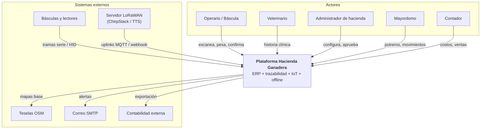
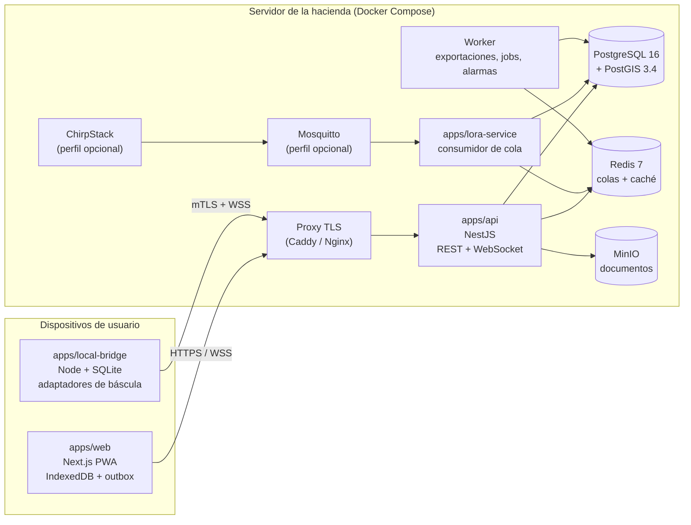
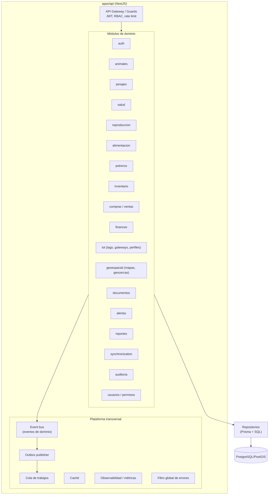
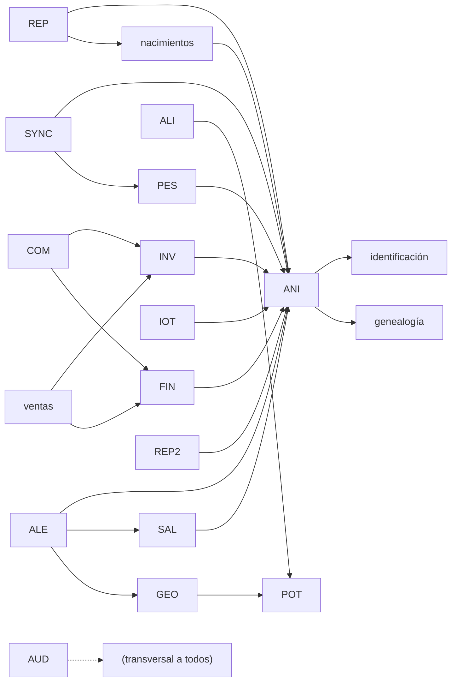
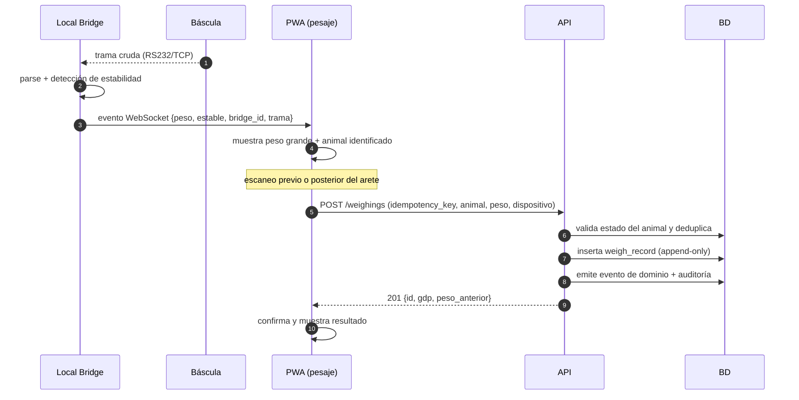
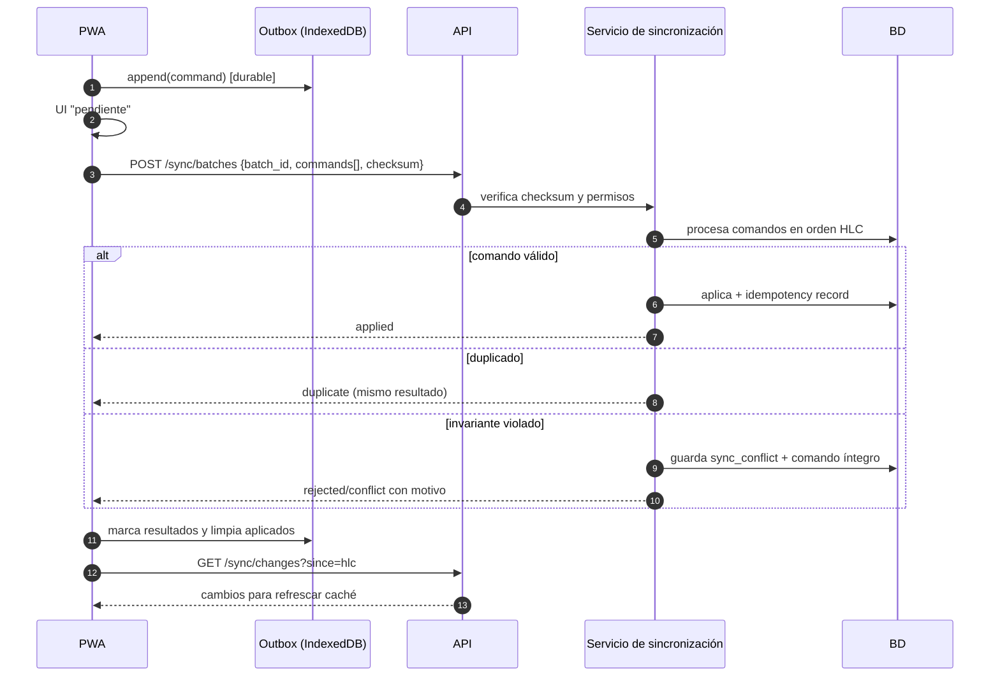
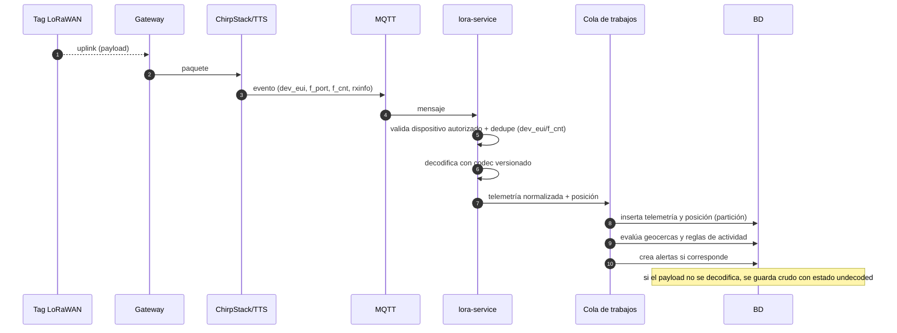
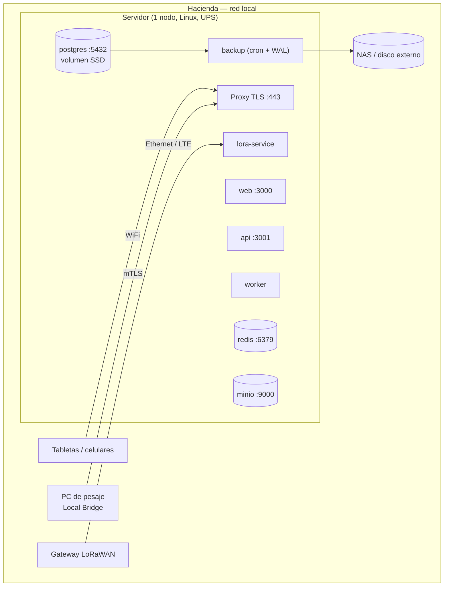

# Arquitectura de la plataforma — Hacienda Ganadera

**Documento:** `docs/02-arquitectura.md`
**Versión:** 1.0.0
**Fecha:** 2026-11-10
**Requisitos que implementa:** `docs/01-especificacion-corregida.md` §8, §9, §11, §12, §13
**Diagramas fuente:** `docs/diagrams/*.mmd`

---

## 1. Principios rectores

| # | Principio | Consecuencia arquitectónica |
|---|---|---|
| P1 | **El campo manda.** Si el sistema exige red para trabajar, no se usa. | Escritura local primero (outbox), servidor reconciliador. |
| P2 | **El servidor decide los invariantes.** | Máquinas de estado y unicidad en el dominio del backend, nunca en la UI. |
| P3 | **La historia no se reescribe.** | Eventos append-only + auditoría encadenada. |
| P4 | **El hardware es desconocido por definición.** | Puertos y adaptadores; el ERP no conoce marcas. |
| P5 | **Lo que no se puede verificar no se promete.** | Estados de integración `declared/simulated/lab_verified/field_verified`. |
| P6 | **Local primero, nube opcional.** | Un solo `docker compose up` debe levantar todo en la hacienda. |
| P7 | **Fallar de forma visible.** | El sistema dice qué está degradado y desde cuándo. |

---

## 2. Vista de contexto (C4 — nivel 1)



**Fronteras de confianza:**

| Zona | Elementos | Nivel de confianza |
|---|---|---|
| Z0 — Campo | básculas, lectores, tags, gateways | No confiable: datos crudos, validados al entrar |
| Z1 — Puesto de pesaje | Local Bridge | Confiable **si** el certificado de cliente es válido (mTLS) |
| Z2 — Servidor de la hacienda | API, web, base, colas, MinIO | Zona protegida (red local, cortafuegos) |
| Z3 — Borde | proxy TLS | Único punto expuesto |
| Z4 — Nube (opcional) | réplica de respaldo | Confianza limitada, cifrado en tránsito y reposo |

---

## 3. Vista de contenedores (C4 — nivel 2)



### 3.1 Responsabilidades

| Contenedor | Responsabilidad | NO hace |
|---|---|---|
| `apps/web` | UI, caché offline, cola outbox, validación de forma | Autorizar, calcular invariantes, decidir conflictos |
| `apps/api` | Dominio, autorización, persistencia, WebSocket, API pública | Hablar con hardware |
| `apps/local-bridge` | Hardware de pesaje, cola durable local, diagnóstico | Lógica de negocio, cálculo de GDP |
| `apps/lora-service` | Ingesta, deduplicación, decodificación, geocercas | Exponer API a usuarios |
| Worker | Exportaciones, jobs programados, verificación de auditoría, alertas | Atender peticiones de usuario |
| PostgreSQL/PostGIS | Verdad persistente, integridad, consultas espaciales | Lógica de aplicación |
| Redis | Colas (BullMQ), caché, rate limiting | Verdad persistente de negocio |
| MinIO | Documentos y exportaciones | Servir contenido sin firmar |

---

## 4. Vista de componentes del backend (C4 — nivel 3)



### 4.1 Regla de dependencia entre módulos

Un módulo de dominio **puede** emitir y consumir eventos de otro; **no puede** importar sus repositorios.
La comunicación entre módulos es por eventos de dominio y servicios de aplicación expuestos, no por acceso
directo a tablas ajenas. Esto evita el monolito espagueti sin obligar a microservicios.



---

## 5. Flujos principales

### 5.1 Pesaje con báscula (camino feliz)



Puntos de diseño:

- El **bridge no decide** si el pesaje es válido para el negocio; solo informa estabilidad y trama.
- La PWA **no calcula** GDP ni inventario: los recibe.
- Si la API no responde, la PWA guarda el pesaje en outbox y responde al operario con estado
  "pendiente de sincronizar" (marcado visiblemente). El bridge lo guarda además en su SQLite.

### 5.2 Sincronización offline



### 5.3 Ingesta IoT



### 5.4 Evaluación de geocercas

1. Se ubica el punto en el potrero (`ST_Contains` sobre `potrero.geom`).
2. Se compara con el último estado conocido del animal en ese potrero.
3. Se aplican reglas de antifalsas alarmas: precisión mínima, permanencia mínima, N posiciones
   consecutivas, histéresis y cooldown.
4. Solo si se cumplen todas se emite `geofence_event` y la alerta correspondiente.
5. Toda posición se guarda aunque no genere evento (histórico).

---

## 6. Despliegue

### 6.1 Local (por defecto)



### 6.2 Híbrido (opcional)

- Réplica de respaldo cifrada hacia almacenamiento en nube (solo respaldos, no operación).
- Servidor LoRaWAN en la nube (The Things Stack) con *webhook* hacia el servidor local por túnel saliente.
- Nada de lo anterior es requisito para operar: la plataforma funciona 100 % local.

### 6.3 Puertos y exposición

| Servicio | Puerto | Exposición |
|---|---|---|
| Proxy | 443 | LAN (y WAN solo si se habilita acceso remoto con VPN) |
| web / api | 3000 / 3001 | Solo interno |
| postgres / redis / minio | 5432 / 6379 / 9000 | Solo interno (nunca a LAN) |
| Local Bridge | sin puerto entrante | Saliente únicamente |

---

## 7. Arquitectura del frontend

### 7.1 Stack

| Pieza | Elección | Motivo |
|---|---|---|
| Framework | Next.js (App Router) + React + TypeScript | SSR para carga rápida, RSC para datos, ecosistema |
| Estilos | Tailwind CSS + shadcn/ui (Radix) | Rapidez, accesibilidad, control de contraste (ADR-0008) |
| Estado servidor | TanStack Query | Caché, reintentos, invalidación |
| Estado local/offline | Zustand + Dexie (IndexedDB) | Simple, persistente, sin magia |
| Formularios | React Hook Form + Zod | Validación compartida con backend (`packages/contracts`) |
| Gráficos | Recharts | Suficiente para curvas de crecimiento e indicadores |
| Mapas | Leaflet o MapLibre (ADR-0009) | OSM, sin costo de licencia |
| PWA | Service Worker propio + Workbox | Control explícito de caché y outbox |

### 7.2 Estructura por capas

```text
apps/web/src
├── app/                 # rutas (App Router): (auth), (dashboard), animales, pesaje, mapa...
├── features/            # módulos de UI por dominio: animales, pesajes, salud...
│   └── <feature>/{components,hooks,api,schemas}
├── components/ui/       # primitivas (botón, tabla, filtro, tarjeta, badge de estado)
├── lib/                 # http, queryClient, permisos, formatos (kg/@), fechas
├── offline/             # dexie, outbox, sync-engine, conflict-ui
└── styles/
```

### 7.3 Reglas de UI

- **RNF-USA-01…05** (contraste, 48 px, 2 toques en pesaje).
- Toda cifra derivada (GDP, costo/kg, utilidad) muestra **cómo se calcula** (tooltip con fórmula).
- Toda fecha relativa ("hace 3 h") muestra también la absoluta.
- Todo dato simulado lleva banda visible (`INV-08`).
- Toda posición muestra su **tipo** (GPS / estimada / cobertura de gateway / administrativa / última conocida).
- Botones deshabilitados explican el motivo.

---

## 8. Arquitectura del backend

### 8.1 Estilo

Monolito modular NestJS: un despliegue, fronteras de módulo estrictas. Los módulos con carga muy distinta
(ingesta IoT, exportaciones) se separan como **workers** que consumen la misma cola y comparten base.

### 8.2 Capas por módulo

```text
<modulo>/
├── <modulo>.controller.ts     # HTTP, DTOs de entrada, guards
├── <modulo>.service.ts        # casos de uso
├── domain/                    # entidades, invariantes, máquinas de estado (sin framework)
├── <modulo>.repository.ts     # persistencia (Prisma / SQL)
└── events/                    # eventos emitidos y manejadores
```

Regla: `domain/` no importa nada de NestJS, Prisma ni HTTP. Es la parte con mayor cobertura de pruebas.

### 8.3 Patrones obligatorios

| Patrón | Uso | Por qué |
|---|---|---|
| **Outbox** | Todo evento de dominio se persiste en la misma transacción que el cambio | Nunca se emite un evento de un cambio que no se confirmó |
| **Idempotencia** | Tabla `idempotency_record` + middleware | Reintentos de red no duplican |
| **Unit of Work** | Transacción por caso de uso | Sin estados intermedios |
| **Optimistic locking** | `version` en entidades sincronizables | Detecta edición concurrente |
| **Máquina de estados** | `animal.status` | Transiciones inválidas imposibles |
| **Filtro global de errores** | Mapeo a códigos estables | Nunca se filtra stack trace (`RF-SEG-15`) |
| **Auditoría automática** | Interceptor + eventos | No depende de que el programador se acuerde |

### 8.4 API

- REST versionada (`/api/v1`), OpenAPI 3.1 generada desde decoradores.
- WebSocket (`/ws`): estado de báscula en vivo, notificaciones, progreso de exportación.
- Paginación por cursor en tablas grandes; offset solo en catálogos.
- Errores con `code` estable (`ANIMAL_SOLD`, `SCALE_UNSTABLE`, `DUPLICATE_WEIGHT`), no solo texto.

---

## 9. Arquitectura PostgreSQL / PostGIS

### 9.1 Roles de base de datos

| Rol | Permisos | Uso |
|---|---|---|
| `migrator` | DDL | Solo migraciones |
| `app_rw` | DML en tablas operativas; **sin** UPDATE/DELETE en inmutables | API |
| `app_ro` | SELECT | Reportes |
| `backup` | SELECT + replicación | Respaldos |
| `lora_svc` | INSERT en telemetría/posiciones | Servicio IoT |

La aplicación **nunca** conecta como `postgres`.

### 9.2 Estrategia geoespacial

- `geography(Point,4326)` para posiciones puntuales (distancias en metros, sin proyección).
- `geometry(Polygon,4326)` para potreros y geocercas; índices `GIST`.
- Índice compuesto `(animal_id, recorded_at DESC)` en posiciones; `GIST` en `geom`.
- Consultas "última posición por animal" resueltas con vista materializada refrescada en cada lote, no con
  `DISTINCT ON` sobre millones de filas.
- `ST_Contains` para pertenencia a potrero, con pre-filtro por `ST_Expand` del bounding box.

### 9.3 Particionamiento y retención

| Tabla | Partición | Retención por defecto |
|---|---|---|
| `iot_position` | RANGE mensual por `recorded_at` | 24 meses (configurable) |
| `iot_telemetry` | RANGE mensual | 24 meses |
| `audit_log` | RANGE anual | ≥ 10 años |
| `domain_event` | RANGE anual | ≥ 10 años |

Las particiones se crean con antelación por un job (nunca "on demand" en caliente).

### 9.4 Integridad

- FKs con `ON DELETE RESTRICT` en entidades críticas (nada se borra en cascada).
- `CHECK` para `location_type` ↔ lat/lon (`INV-04`).
- Triggers: `updated_at`, inmutabilidad, cálculo de `hash` de auditoría, prohibición de transiciones
  inválidas de estado.
- Exclusiones: un rango de ocupación de potrero por animal no puede solaparse (`EXCLUDE USING gist`).

---

## 10. Local Bridge

```text
apps/local-bridge
├── src/main.ts               # arranque, bandeja, modo servicio
├── src/server.ts             # WebSocket/REST local hacia la PWA + saliente al ERP
├── src/hardware/
│   ├── transport/{serial,tcp,usb-hid}.ts
│   ├── adapters/             # ScaleProtocolAdapter v1
│   │   ├── generic-ascii.ts
│   │   ├── <marca>-<modelo>.ts   (se agregan sin tocar el ERP)
│   │   └── index.ts (registro)
│   └── stability.ts          # RF-BAS-05
├── src/queue/                # SQLite durable, firma, idempotencia
├── src/enrollment/           # código de un solo uso → certificado
└── src/diagnostics/          # lectura en vivo, log rotativo
```

Decisiones:

- Node.js + TypeScript (mismo lenguaje, misma librería de protocolos compartida).
- Empaquetado como ejecutable por sistema operativo; instalación como servicio.
- **Sin puertos entrantes**: la PWA se conecta a `localhost` y el bridge sale al ERP.
- Cola local **firmada** y con `bridge_id`; el servidor rechaza comandos de un bridge no enrolado.

---

## 11. Servicio de integración LoRaWAN

```text
apps/lora-service
├── src/ingest/mqtt.ts          # suscripción ChirpStack/TTS
├── src/ingest/webhook.ts       # alternativa por webhook
├── src/codec/                  # decodificadores versionados por modelo
├── src/dedupe.ts               # dev_eui + f_cnt + gateway
├── src/telemetry.ts            # normalización y unidad
├── src/geofence.ts             # evaluación con histéresis
├── src/presence.ts             # tag sin comunicación, batería
└── src/publisher.ts            # cola interna
```

Contrato de ingesta (independiente del servidor LoRaWAN): un mensaje normalizado con
`dev_eui, f_port, f_cnt, received_at, gateways[], rssi, snr, payload_b64, codec_hint`. Cualquier servidor que
pueda producir ese mensaje es compatible; por eso ChirpStack y TTS son intercambiables.

---

## 12. Seguridad

### 12.1 Controles por capa

| Capa | Controles |
|---|---|
| Red | Segmentación, cortafuegos, solo 443 expuesto, VPN para acceso remoto |
| Transporte | TLS 1.2+, HSTS, mTLS para bridge |
| Aplicación | JWT corto, refresh rotativo, RBAC + alcance, rate limit, CSP, CSRF |
| Datos | Cifrado en reposo, PII con crypto-shredding, roles de BD sin superusuario |
| Operación | Auditoría encadenada, respaldos verificados, secretos fuera del código |
| Dispositivos | Enrolamiento, rotación de claves, revocación, dedupe de mensajes |

### 12.2 Modelo de amenazas (resumen STRIDE)

| Amenaza | Vector | Mitigación |
|---|---|---|
| Suplantación | Robo de token de sesión | Access corto + refresh rotativo + revocación por familia |
| Manipulación | Bridge falso inyectando pesajes | mTLS + enrolamiento + firma de lote + auditoría |
| Repudio | "Yo no anulé esa venta" | Auditoría encadenada con actor y timestamp |
| Divulgación | Documentos accesibles por URL | URLs prefirmadas 5 min + autorización por entidad |
| Denegación | Inundación de la API | Rate limit + cola + límites de payload |
| Elevación | IDOR entre fincas | Validación de alcance en consulta |
| Inyección LoRaWAN | Payload repetido o falsificado | Dedupe `f_cnt`, dispositivos autorizados, codecs validados |

---

## 13. Observabilidad

| Señal | Herramienta | Retención |
|---|---|---|
| Logs estructurados | Loki / archivos rotativos | 90 días |
| Métricas | Prometheus + Grafana | 13 meses |
| Trazas | OpenTelemetry (Tempo opcional) | 30 días |
| Auditoría de negocio | PostgreSQL | ≥ 10 años |
| Estado de hardware | Panel propio (bridge, gateways, tags) | Indefinido (agregado) |

Paneles mínimos: API (latencia p95, errores), base (conexiones, locks, tamaño), cola (profundidad, edad del
mensaje más viejo), IoT (uplinks/s, decodificaciones fallidas, tags mudos), bridge (conectados, cola local),
respaldos (último éxito, verificación).

---

## 14. Dependencias principales

| Dependencia | Versión objetivo | Uso | Riesgo / nota |
|---|---|---|---|
| Node.js | 22 LTS | Backend, bridge, scripts | Fijado con `.nvmrc` |
| TypeScript | 5.x | Todo el código | `strict: true` |
| Next.js | 15.x | Frontend PWA | App Router; SSR para arranque rápido |
| React | 19.x | UI | — |
| NestJS | 11.x | API | Módulos, DI, guards |
| Prisma | 6.x | ORM del dominio | No genera migraciones de esquema (ADR-0002) |
| PostgreSQL | 16 | Base | — |
| PostGIS | 3.4 | Geoespacial | Extensión `postgis`, `postgis_raster` opcional |
| Redis | 7 | Colas y caché | Persistencia AOF para colas |
| BullMQ | 5.x | Colas | Reintentos, dead letter |
| MinIO | última estable | Documentos S3 | Compatible S3 |
| ChirpStack | 4.x | Servidor LoRaWAN (opcional) | Perfil de compose separado |
| Mosquitto | 2.x | Broker MQTT | Solo red interna |
| Caddy | 2.x | Proxy TLS | Certificados locales o Let's Encrypt |
| Leaflet / MapLibre | 1.9 / 4.x | Mapas | Decisión en ADR-0009 |
| Zod | 3.x | Validación compartida | `packages/contracts` |
| Vitest + Playwright | últimas | Pruebas | Unitarias/integración y E2E |
| k6 | última | Carga | Pruebas de rendimiento |
| Argon2 | — | Hash de contraseñas | Parámetros calibrados |

**Regla:** toda dependencia nueva entra con ADR si es infraestructura, y con justificación en el PR si es
librería. Sin `latest` en producción; versiones fijadas por lockfile e imagen por digest.

---

## 15. Escalabilidad y cuellos de botella esperados

| Punto | Límite esperado | Mitigación diseñada |
|---|---|---|
| Ingesta IoT | Miles de msg/s teóricos, 50 msg/s reales | Cola + worker horizontal + dedupe rápido en Redis |
| Tabla de posiciones | Crecimiento mensual alto | Particiones + retención + vista materializada de última posición |
| Reportes agregados | Consultas pesadas | Cola asíncrona + índices + caché de resultados |
| Mapas | Miles de puntos | Clustering en cliente + *bbox* en servidor + último estado materializado |
| Exportaciones | Archivos grandes | Worker + streaming + URL firmada |
| Escrituras concurrentes de pesaje | Baja (1 báscula) | Sin problema; el cuello es la red, no la base |

**Camino de crecimiento a 5.000 dispositivos:** no cambia la arquitectura; se añaden workers y se ajustan
particiones/índices. La decisión de microservicios se pospone hasta que exista una medición que lo justifique
(ADR-0010).

---

## 16. Decisiones arquitectónicas registradas

| ADR | Decisión |
|---|---|
| ADR-0001 | Formato y proceso de ADR |
| ADR-0002 | Migraciones SQL como fuente de verdad + Prisma como ORM de dominio |
| ADR-0003 | Contrato de sincronización offline (UUIDv7 + HLC + outbox + política por entidad) |
| ADR-0004 | Inmutabilidad N3 con cadena de hashes y roles de BD |
| ADR-0005 | Local Bridge con mTLS, adaptadores versionados y cola firmada |
| ADR-0006 | Mono-tenant con N fincas y `tenant_id` reservado |
| ADR-0007 | Gestión de secretos y ciclo de vida de dispositivos LoRaWAN |
| ADR-0008 | Tailwind + shadcn/ui como sistema de componentes |
| ADR-0009 | Leaflet vs MapLibre (decisión pendiente de prueba con datos reales) |
| ADR-0010 | Monolito modular, no microservicios |

---

## 17. Fuentes de los diagramas

Cada diagrama de este documento tiene su fuente versionada en `docs/diagrams/`. Editar el `.mmd` y luego
sincronizar el bloque del documento; nunca al revés.

| Archivo | Diagrama | Sección |
|---|---|---|
| `01-contexto-c4.mmd` | Contexto C4 (nivel 1) | §2 |
| `02-contenedores-c4.mmd` | Contenedores C4 (nivel 2) | §3 |
| `03-componentes-backend.mmd` | Componentes del backend (nivel 3) | §4 |
| `04-dependencias-modulos.mmd` | Dependencias entre módulos de dominio | §4.1 |
| `05-secuencia-pesaje.mmd` | Flujo de pesaje con báscula | §5.1 |
| `06-secuencia-sincronizacion.mmd` | Sincronización offline con conflictos | §5.2 |
| `07-secuencia-ingesta-iot.mmd` | Ingesta LoRaWAN | §5.3 |
| `08-despliegue-local.mmd` | Despliegue local en la hacienda | §6.1 |
| `09-estados-animal.mmd` | Máquina de estados del animal | `docs/01` §7 |
| `10-modelo-er.mmd` | Núcleo del modelo entidad-relación | `docs/03` §2 |

Render local (opcional, requiere `@mermaid-js/mermaid-cli`):

```bash
npx -y @mermaid-js/mermaid-cli -i docs/diagrams/02-contenedores-c4.mmd -o build/02-contenedores.svg
```
