# Modelo de datos — PostgreSQL 16 + PostGIS 3.4

**Documento:** `docs/03-modelo-de-datos.md`
**Versión:** 1.0.0
**Fecha:** 2026-11-10
**Estado:** diseño normativo de la Fase 1 (DDL de referencia, no código de aplicación)
**Relacionado:** ADR-0002 (migraciones SQL), ADR-0003 (sincronización), ADR-0004 (inmutabilidad)

---

## 1. Convenciones

| Convención | Regla |
|---|---|
| Nombres | `snake_case`, tablas en singular, sin prefijos redundantes |
| Clave primaria | `id uuid` (UUIDv7 para entidades creadas en cliente; `gen_random_uuid()` para catálogos) |
| Auditoría mínima | `created_at timestamptz NOT NULL DEFAULT now()`, `updated_at timestamptz NOT NULL DEFAULT now()`, `created_by uuid`, `updated_by uuid` |
| Borrado | `deleted_at timestamptz` (anulación) **solo** en entidades anulables; nunca en inmutables |
| Dinero | `numeric(14,2)` en la moneda de la instalación + `moneda char(3)` cuando se mezcle |
| Peso | `numeric(8,2)` en **kg** (unidad canónica, §5.10 de la especificación) |
| Fechas | `timestamptz` en UTC; `date` para fechas sin hora (nacimiento, celo) |
| Estados | `text` + `CHECK` contra catálogo, no `enum` de PostgreSQL (evita bloqueos de migración) |
| FKs | `ON DELETE RESTRICT` por defecto; `CASCADE` solo en tablas de detalle no críticas |
| Índices | Nombre `ix_<tabla>_<columnas>`; únicos `uq_<tabla>_<columnas>` |
| Documentación | `COMMENT ON TABLE` obligatorio para tablas de dominio |

---

## 2. Vista entidad-relación — núcleo del animal

```mermaid
erDiagram
    FINCA ||--o{ POTRERO : "contiene"
    FINCA ||--o{ ANIMAL : "aloja"
    FINCA ||--o{ USUARIO_FINCA : "autoriza"
    USUARIO ||--o{ USUARIO_FINCA : "tiene"
    ROL ||--o{ USUARIO_ROL : "asigna"
    USUARIO ||--o{ USUARIO_ROL : "recibe"
    ROL ||--o{ ROL_PERMISO : "incluye"
    PERMISO ||--o{ ROL_PERMISO : "concede"

    ANIMAL ||--o{ ANIMAL_IDENTIFICACION : "porta"
    ANIMAL ||--o{ PESAJE : "registra"
    ANIMAL ||--o{ EVENTO_CLINICO : "sufre"
    ANIMAL ||--o{ VACUNACION : "recibe"
    ANIMAL ||--o{ SERVICIO_REPRODUCTIVO : "hembra"
    ANIMAL ||--o{ PARTO : "madre"
    ANIMAL ||--o{ MOVIMIENTO_POTRERO : "se desplaza"
    ANIMAL ||--o{ ASIGNACION_TAG : "porta"
    ANIMAL ||--o{ MOVIMIENTO_INVENTARIO : "genera"
    ANIMAL ||--o{ DOCUMENTO : "adjunta"
    ANIMAL ||--o{ CONFLICTO_SYNC : "afecta"

    RAZA ||--o{ ANIMAL : "clasifica"
    CATEGORIA ||--o{ ANIMAL : "deriva"
    POTRERO ||--o{ MOVIMIENTO_POTRERO : "origen/destino"
    BASCULA ||--o{ PESAJE : "mide"
    TAG ||--o{ ASIGNACION_TAG : "asignado"
    GATEWAY ||--o{ POSICION : "recibe"
    TAG ||--o{ POSICION : "emite"
    TAG ||--o{ TELEMETRIA : "emite"
    GEOCERCA ||--o{ EVENTO_GEOCERCA : "dispara"

    COMPRA ||--o{ COMPRA_DETALLE : "incluye"
    VENTA ||--o{ VENTA_DETALLE : "incluye"
    ANIMAL ||--o{ VENTA_DETALLE : "vendido"
    DOCUMENTO }o--|| ENTIDAD_TIPO : "clasifica"

    USUARIO ||--o{ AUDIT_LOG : "actúa"
    USUARIO ||--o{ SESION : "abre"
```



---

## 3. Catálogo de tablas

Leyenda de la columna **Clase**: `M` = maestra/catálogo, `T` = transaccional, `E` = evento (append-only),
`R` = relación, `S` = sistema/seguridad, `P` = particionada.

### 3.1 Seguridad y usuarios

| Tabla | Clase | Propósito | Columnas principales |
|---|---|---|---|
| `usuario` | S | Cuenta de acceso | `id, email (uq), password_hash, nombre, activo, mfa_secret_enc, bloqueado_hasta, ultimo_acceso_at` |
| `rol` | M | Rol del sistema | `id, codigo (uq), nombre, sistema (bool)` |
| `permiso` | M | Permiso atómico | `id, modulo, operacion, codigo (uq)` |
| `rol_permiso` | R | Permisos por rol y alcance | `rol_id, permiso_id, alcance` |
| `usuario_rol` | R | Roles por usuario | `usuario_id, rol_id, finca_id (nullable)` |
| `usuario_finca` | R | Acceso a fincas | `usuario_id, finca_id, es_predeterminada` |
| `sesion` | S | Sesiones activas | `id, usuario_id, refresh_family, user_agent, ip, expira_at, revocada_at` |
| `intento_login` | S | Intentos fallidos | `id, email, ip, exito, motivo, created_at` |
| `snapshot_permisos` | S | Snapshot firmado para offline | `id, usuario_id, device_id, payload_jwt, expira_at` |

### 3.2 Configuración y catálogos

| Tabla | Clase | Propósito | Columnas principales |
|---|---|---|---|
| `finca` | M | Predio | `id, codigo, nombre, propietario, identificacion_tributaria, geom (Polygon), direccion, zona_horaria` |
| `configuracion` | M | Parámetros versionados | `id, finca_id, clave, valor_json, version, vigente_desde` |
| `catalogo` | M | Catálogos maestros | `id, tipo, codigo, nombre, version, source, activo, metadata` |
| `unidad_medida` | M | Unidades y factores | `id, codigo, nombre, factor_kg, es_canonica` |
| `moneda` | M | Moneda activa | `id, codigo, simbolo, decimales` |
| `raza` | M | Razas y cruces | `id, codigo, nombre, especie, origen` |
| `categoria_animal` | M | Categorías derivadas | `id, codigo, nombre, sexo, edad_min_meses, edad_max_meses` |

### 3.3 Animal e identificación

| Tabla | Clase | Propósito | Columnas principales |
|---|---|---|---|
| `animal` | T | Entidad raíz | `id, finca_id, arete (uq por finca), codigo_barras (uq global), rfid, nombre, sexo, fecha_nacimiento, peso_nacimiento_kg, raza_id, cruce_racial, color, caracteristicas, procedencia, madre_id, padre_id, tipo_nacimiento, estado, estado_productivo, condicion_corporal, potrero_id, lote_id, corral, foto_id, identificacion_oficial, observaciones, version, hlc, deleted_at` |
| `animal_identificacion` | R | Historial de identificadores | `id, animal_id, tipo, valor, vigente_desde, vigente_hasta, estado (active/retired)` |
| `animal_estado_historial` | E | Transiciones de estado | `id, animal_id, estado_anterior, estado_nuevo, motivo, actor_id, occurred_at` |
| `animal_peso_resumen` | T | Desnormalización para rendimiento | `animal_id, peso_actual_kg, peso_anterior_kg, delta_kg, gdp_diaria, fecha_ultimo_pesaje, updated_at` |

### 3.4 Pesaje y báscula

| Tabla | Clase | Propósito | Columnas principales |
|---|---|---|---|
| `bascula` | M | Báscula física | `id, finca_id, nombre, marca, modelo, serie, protocol_id, transporte, config_json (baud, paridad, bits), tolerance_kg, window_ms, min_samples, min_kg, max_kg, estado_integracion` |
| `pesaje` | E | Medición inmutable | `id, animal_id, finca_id, bascula_id, bridge_id, peso_kg, tipo, ocurrido_at, recibido_at, registrado_por, edad_dias, observaciones, origen (FIELD/SIMULATOR/IMPORT), duplicate_of, trama_cruda, hlc, idempotency_key (uq), audit_hash` |

### 3.5 Salud

| Tabla | Clase | Propósito | Columnas principales |
|---|---|---|---|
| `vacunacion` | E | Aplicación de vacuna | `id, animal_id, vacuna_id, enfermedad_objetivo, fecha, dosis, lote_vacuna, laboratorio, via, proxima_aplicacion, veterinario_id, observaciones, origen` |
| `evento_clinico` | E | Enfermedad/lesión/cirugía | `id, animal_id, tipo, fecha, sintomas, diagnostico, gravedad, resultado, costo, veterinario_id` |
| `tratamiento` | E | Tratamiento aplicado | `id, evento_clinico_id, medicamento_id, dosis, unidad, inicio, fin, dias_retiro, responsable_id, costo` |
| `medicamento` | M | Catálogo | `id, nombre, principio_activo, laboratorio, unidad, dias_retiro_default` |
| `examen` | T | Exámenes y laboratorio | `id, animal_id, tipo, fecha, resultado, laboratorio, documento_id` |
| `cuarentena` | T | Aislamiento | `id, animal_id, motivo, inicio, fin, aprobada_por` |

### 3.6 Reproducción y genealogía

| Tabla | Clase | Propósito |
|---|---|---|
| `servicio_reproductivo` | E | Monta o inseminación (hembra, macho/pajilla, fecha, tipo, responsable) |
| `diagnostico_prenez` | E | Resultado, método, fecha, fecha probable de parto |
| `parto` | E | Fecha/hora, tipo, crías, aborto, complicaciones |
| `cria_parto` | R | Vínculo parto ↔ animal cría |
| `celo` | T | Fecha, intensidad, observaciones |
| `genealogia_validacion` | S | Registro de validaciones ejecutadas (ciclos, sexo, fechas) |

### 3.7 Potreros, alimentación y movimientos

| Tabla | Clase | Propósito |
|---|---|---|
| `potrero` | M | `id, finca_id, codigo, nombre, area_ha, geom (Polygon,4326), tipo_pasto, capacidad, estado, observaciones` |
| `lote` | M | Agrupación operativa |
| `movimiento_potrero` | E | `animal_id, potrero_origen_id, potrero_destino_id, desde, hasta, motivo, actor_id` (con exclusión de solape) |
| `insumo` | M | Concentrados, sales, pastos, forrajes, silos |
| `plan_nutricional` | M | Plan por categoría/etapa/potrero con vigencia |
| `plan_nutricional_detalle` | R | Insumo, cantidad, frecuencia |
| `consumo_insumo` | T | Consumo real con costo y responsable |
| `silo` | M | Capacidad, nivel, merma |

### 3.8 Inventario, compras, ventas y finanzas

| Tabla | Clase | Propósito |
|---|---|---|
| `movimiento_inventario` | E | `tipo (compra/nacimiento/venta/muerte/traslado/sacrificio/ajuste), animal_id, fecha, actor_id, documento_id` |
| `compra` | T | Proveedor, fecha, total, transporte, otros costos |
| `compra_detalle` | R | Animal, peso, precio/kg, subtotal |
| `venta` | T | Cliente, fecha, total, gastos, estado, moneda |
| `venta_detalle` | R | Animal o lote, peso, precio/kg, base de precio (kg/@), subtotal |
| `gasto` | T | Categoría, monto, fecha, centro de costo, imputación (animal/lote/potrero/finca) |
| `ingreso` | T | Concepto, monto, fecha |
| `centro_costo` | M | Agrupación contable-operativa |
| `regla_imputacion` | M | `allocation_rule` para costos indirectos |
| `periodo_contable` | M | Mes/año, estado (abierto/cerrado), cerrado_por |

### 3.9 IoT

| Tabla | Clase | Propósito |
|---|---|---|
| `dispositivo` | M | Base común: `deveui (uq), tipo, marca, modelo, serie, firmware, estado_ciclo, estado_integracion` |
| `tag` | M | `dispositivo_id, tecnologia, has_gnss, has_accelerometer, bateria_pct, ultima_transmision_at, perfil_actual_id` |
| `asignacion_tag` | R | `tag_id, animal_id, desde, hasta, motivo` (exclusión: un tag activo en un solo animal) |
| `gateway` | M | `id, nombre, marca, modelo, serie, ubicacion (Point), altura_m, ip, backhaul, estado, ultima_comunicacion_at` |
| `perfil_transmision` | M | `id, nombre, version, intervalo_s, dr, potencia, version_inmutable` |
| `asignacion_perfil` | R | `tag_id, perfil_id, vigente_desde, vigente_hasta` |
| `telemetria` | P/E | `tag_id, recibido_at, bateria_pct, movimiento, temperatura, payload_crudo, codec_id, codec_version, decodificado` |
| `posicion` | P/E | `tag_id, animal_id, geom (Point,4326), location_type, accuracy_m, satellites, fix_time, rssi, snr, gateway_id, recibido_at` |
| `geocerca` | M | `id, finca_id, nombre, tipo, geom (Polygon), reglas_json` |
| `evento_geocerca` | E | `geocerca_id, animal_id, tipo (salida/entrada/permanencia/concentracion), occurred_at, posicion_id` |
| `regla_alerta` | M | `id, tipo, severidad, condicion_json, destinatarios, horario, escalamiento` |
| `alerta` | T | `id, regla_id, entidad, entidad_id, severidad, mensaje, estado (abierta/reconocida/cerrada), asignada_a, created_at` |
| `notificacion` | T | `alerta_id, canal, destinatario, enviado_at, confirmado_at, error` |

### 3.10 Documentos y sistema

| Tabla | Clase | Propósito |
|---|---|---|
| `documento` | T | `id, entidad_tipo, entidad_id, tipo, nombre_original, mime_real, tamano_bytes, checksum_sha256 (uq), storage_key, contains_pii, subido_por, estado` |
| `evento_dominio` | P/E | `id, tipo, entidad, entidad_id, payload_json, actor_id, occurred_at, recorded_at, hlc, origin, request_id, prev_hash, hash` |
| `audit_log` | P/E | `id, occurred_at, actor_id, action, entity, entity_id, before_json, after_json, prev_hash, hash, ip, user_agent, request_id, resultado` |
| `outbox` | S | `id, agregado, agregado_id, tipo_evento, payload, intentos, disponible_en, procesado_at` |
| `idempotency_record` | S | `key (pk), usuario_id, endpoint, request_hash, response_json, created_at, expira_at` |
| `sync_batch` | S | `id, device_id, usuario_id, recibido_at, count, checksum, estado` |
| `sync_command` | S | `id, batch_id, batch_index, entidad, entidad_id, operacion, payload, hlc, idempotency_key, estado (pending/applied/duplicate/conflict/rejected), motivo` |
| `sync_conflict` | S | `id, command_id, entidad, entidad_id, campo, valor_cliente, valor_servidor, politica, resuelto_por, resuelto_at, decision` |
| `job_ejecucion` | S | `id, tipo, estado, inicio, fin, error, payload` |

**Total:** 68 tablas + particiones mensuales de `posicion`/`telemetria` y anuales de `evento_dominio`/`audit_log`.

### 3.11 Animales (Fase 2)

| Tabla | Clase | Propósito |
|---|---|---|
| `raza` | M | Catálogo de razas; las sembradas se marcan `source = 'SEED'` hasta validación del negocio |
| `categoria_animal` | M | Categorías del hato; la del animal es **derivada**, no un campo |
| `lote` | M | Agrupación operativa por finca |
| `animal` | T | Ficha única; arete único por finca, código de barras único global, genealogía con FK |
| `animal_identificacion` | R | Historial de identificadores; uno retirado no se reutiliza (índice único parcial) |
| `animal_estado_historial` | E | Transiciones de estado, append-only |

Funciones y vistas: `app.edad_meses`, `app.categoria_de` y `app.v_animal_resumen` (lectura con edad y
categoría calculadas). La regla de categoría debe coincidir con `apps/api/src/animales/domain/categoria.ts`;
hay una prueba que lo verifica.

---

## 4. DDL de referencia (tablas críticas)

> Estas sentencias son **diseño**. La implementación vive en `infra/postgres/migrations/` (Fase 1) y se aplica
> con la herramienta de migraciones elegida en ADR-0002.

### 4.1 Extensión y esquema

```sql
CREATE EXTENSION IF NOT EXISTS postgis;
CREATE EXTENSION IF NOT EXISTS pgcrypto;
CREATE EXTENSION IF NOT EXISTS btree_gist;

CREATE SCHEMA IF NOT EXISTS app;
SET search_path = app, public;
```

### 4.2 Animal

```sql
CREATE TABLE animal (
  id                    uuid PRIMARY KEY,
  finca_id              uuid NOT NULL REFERENCES finca(id),
  arete                 text NOT NULL,
  codigo_barras         text NOT NULL,
  rfid                  text,
  nombre                text,
  sexo                  text NOT NULL CHECK (sexo IN ('MACHO','HEMBRA')),
  fecha_nacimiento      date,
  peso_nacimiento_kg    numeric(8,2) CHECK (peso_nacimiento_kg > 0),
  raza_id               uuid REFERENCES raza(id),
  cruce_racial          text,
  color                 text,
  caracteristicas       text,
  procedencia           text,
  madre_id              uuid REFERENCES animal(id),
  padre_id              uuid REFERENCES animal(id),
  tipo_nacimiento       text CHECK (tipo_nacimiento IN ('SIMPLE','GEMELO','TRIPLE')),
  estado                text NOT NULL DEFAULT 'activo'
                        CHECK (estado IN ('activo','cuarentena','enfermo','vendido','fallecido','sacrificado','trasladado')),
  estado_productivo     text,
  condicion_corporal    smallint CHECK (condicion_corporal BETWEEN 1 AND 5),
  potrero_id            uuid REFERENCES potrero(id),
  lote_id               uuid REFERENCES lote(id),
  corral                text,
  foto_id               uuid REFERENCES documento(id),
  identificacion_oficial text,
  observaciones         text,
  version               integer NOT NULL DEFAULT 1,
  hlc_physical_ms       bigint,
  hlc_logical           integer,
  hlc_device_id         uuid,
  created_at            timestamptz NOT NULL DEFAULT now(),
  updated_at            timestamptz NOT NULL DEFAULT now(),
  created_by            uuid,
  updated_by            uuid,
  deleted_at            timestamptz,
  CONSTRAINT uq_animal_finca_arete UNIQUE (finca_id, arete),
  CONSTRAINT uq_animal_codigo_barras UNIQUE (codigo_barras),
  CONSTRAINT ck_animal_no_autoparent CHECK (madre_id <> id AND padre_id <> id),
  CONSTRAINT ck_animal_madre_hembra CHECK (madre_id IS NULL OR madre_id <> padre_id)
);

CREATE UNIQUE INDEX uq_animal_rfid ON animal (rfid) WHERE rfid IS NOT NULL AND deleted_at IS NULL;
CREATE INDEX ix_animal_finca_estado ON animal (finca_id, estado) WHERE deleted_at IS NULL;
CREATE INDEX ix_animal_potrero ON animal (potrero_id) WHERE deleted_at IS NULL;
CREATE INDEX ix_animal_nombre_trgm ON animal USING gin (nombre gin_trgm_ops);
```

### 4.3 Pesaje (inmutable)

```sql
CREATE TABLE pesaje (
  id                uuid PRIMARY KEY,
  animal_id         uuid NOT NULL REFERENCES animal(id),
  finca_id          uuid NOT NULL REFERENCES finca(id),
  bascula_id        uuid REFERENCES bascula(id),
  bridge_id         uuid REFERENCES bridge(id),
  peso_kg           numeric(8,2) NOT NULL CHECK (peso_kg > 0),
  tipo              text NOT NULL CHECK (tipo IN ('NACIMIENTO','DESTETE','CONTROL','ENTRADA','SALIDA','OTRO')),
  ocurrido_at       timestamptz NOT NULL,
  recibido_at       timestamptz NOT NULL DEFAULT now(),
  registrado_por    uuid REFERENCES usuario(id),
  edad_dias         integer,
  observaciones     text,
  origen            text NOT NULL CHECK (origen IN ('FIELD','SIMULATOR','IMPORT','MANUAL')),
  duplicate_of      uuid REFERENCES pesaje(id),
  trama_cruda       text,
  clock_skew        boolean NOT NULL DEFAULT false,
  hlc_physical_ms   bigint NOT NULL,
  hlc_logical       integer NOT NULL,
  hlc_device_id     uuid,
  idempotency_key   uuid NOT NULL,
  audit_hash        text NOT NULL,
  CONSTRAINT uq_pesaje_idem UNIQUE (idempotency_key)
);

CREATE INDEX ix_pesaje_animal_fecha ON pesaje (animal_id, ocurrido_at DESC);
CREATE INDEX ix_pesaje_finca_fecha  ON pesaje (finca_id, ocurrido_at DESC);
CREATE INDEX ix_pesaje_dedupe       ON pesaje (animal_id, bascula_id, ocurrido_at)
  WHERE duplicate_of IS NULL;

CREATE FUNCTION app.reject_mutation() RETURNS trigger
LANGUAGE plpgsql AS $$
BEGIN
  RAISE EXCEPTION 'Tabla % es inmutable: use un evento compensatorio (INV-05)', TG_TABLE_NAME;
END $$;

CREATE TRIGGER trg_pesaje_immutable
  BEFORE UPDATE OR DELETE ON pesaje
  FOR EACH ROW EXECUTE FUNCTION app.reject_mutation();
```

### 4.4 Posiciones particionadas por mes

```sql
CREATE TABLE posicion (
  id             uuid NOT NULL,
  tag_id         uuid NOT NULL REFERENCES tag(id),
  animal_id      uuid REFERENCES animal(id),
  geom           geography(Point,4326),
  location_type  text NOT NULL
                 CHECK (location_type IN ('GNSS','ESTIMATED','GATEWAY_COVERAGE','ADMINISTRATIVE','LAST_KNOWN')),
  accuracy_m     numeric(8,2),
  satellites     smallint,
  fix_time       timestamptz,
  bateria_pct    smallint CHECK (bateria_pct BETWEEN 0 AND 100),
  rssi           numeric(6,2),
  snr            numeric(6,2),
  gateway_id     uuid REFERENCES gateway(id),
  potrero_id     uuid REFERENCES potrero(id),
  recibido_at    timestamptz NOT NULL,
  occurred_at    timestamptz,
  PRIMARY KEY (id, recibido_at),
  -- INV-04: coordenada solo si el tipo la justifica
  CONSTRAINT ck_posicion_geom_requerida
    CHECK ( (location_type IN ('GNSS','ESTIMATED') AND geom IS NOT NULL)
         OR (location_type NOT IN ('GNSS','ESTIMATED') AND geom IS NULL) ),
  -- INV-03: GNSS exige fix y precisión
  CONSTRAINT ck_posicion_gnss
    CHECK ( location_type <> 'GNSS'
         OR (satellites IS NOT NULL AND satellites > 0 AND accuracy_m IS NOT NULL) ),
  CONSTRAINT ck_posicion_estimada
    CHECK ( location_type <> 'ESTIMATED' OR (accuracy_m IS NOT NULL AND accuracy_m > 0) )
) PARTITION BY RANGE (recibido_at);

CREATE INDEX ix_posicion_tag_fecha ON posicion (tag_id, recibido_at DESC);
CREATE INDEX ix_posicion_animal_fecha ON posicion (animal_id, recibido_at DESC);
CREATE INDEX ix_posicion_geom ON posicion USING gist (geom);

-- Partición de ejemplo (el job crea las siguientes con antelación)
CREATE TABLE posicion_2026_11 PARTITION OF posicion
  FOR VALUES FROM ('2026-11-01') TO ('2026-12-01');
```

### 4.5 Auditoría encadenada

```sql
CREATE TABLE audit_log (
  id           bigserial NOT NULL,
  occurred_at  timestamptz NOT NULL DEFAULT now(),
  actor_id     uuid,
  action       text NOT NULL,
  entity       text NOT NULL,
  entity_id    text,
  before_json  jsonb,
  after_json   jsonb,
  resultado    text NOT NULL CHECK (resultado IN ('OK','ERROR','DENEGADO')),
  ip           inet,
  user_agent   text,
  request_id   uuid NOT NULL,
  prev_hash    text,
  hash         text NOT NULL,
  PRIMARY KEY (id, occurred_at)
) PARTITION BY RANGE (occurred_at);

CREATE TABLE audit_log_2026 PARTITION OF audit_log
  FOR VALUES FROM ('2026-01-01') TO ('2027-01-01');

CREATE FUNCTION app.audit_chain() RETURNS trigger
LANGUAGE plpgsql AS $$
DECLARE
  v_prev text;
BEGIN
  SELECT hash INTO v_prev FROM audit_log ORDER BY id DESC LIMIT 1;
  NEW.prev_hash := v_prev;
  NEW.hash := encode(
    digest(
      coalesce(NEW.after_json::text,'') || coalesce(NEW.before_json::text,'') ||
      coalesce(v_prev,'') || NEW.occurred_at::text || coalesce(NEW.actor_id::text,'') ||
      NEW.action || NEW.entity || coalesce(NEW.entity_id,''),
      'sha256'
    ), 'hex');
  RETURN NEW;
END $$;

CREATE TRIGGER trg_audit_chain BEFORE INSERT ON audit_log
  FOR EACH ROW EXECUTE FUNCTION app.audit_chain();

CREATE TRIGGER trg_audit_immutable BEFORE UPDATE OR DELETE ON audit_log
  FOR EACH ROW EXECUTE FUNCTION app.reject_mutation();
```

Verificación (job nocturno, también expuesta por endpoint):

```sql
WITH ordered AS (
  SELECT id, occurred_at, prev_hash, hash,
         lag(hash) OVER (ORDER BY id) AS expected_prev
  FROM audit_log
  WHERE occurred_at >= $1 AND occurred_at < $2
)
SELECT id, occurred_at
FROM ordered
WHERE expected_prev IS DISTINCT FROM prev_hash
ORDER BY id
LIMIT 1;   -- una fila = primera ruptura de la cadena
```

### 4.6 Asignación de tag (exclusividad garantizada por la base)

```sql
CREATE TABLE asignacion_tag (
  id         uuid PRIMARY KEY,
  tag_id     uuid NOT NULL REFERENCES tag(id),
  animal_id  uuid NOT NULL REFERENCES animal(id),
  desde      timestamptz NOT NULL,
  hasta      timestamptz,
  motivo     text,
  actor_id   uuid,
  CONSTRAINT ck_asignacion_rango CHECK (hasta IS NULL OR hasta > desde),
  CONSTRAINT ex_asignacion_tag_sin_solape
    EXCLUDE USING gist (
      tag_id WITH =,
      tstzrange(desde, coalesce(hasta, 'infinity')) WITH &&
    )
);

-- Refuerzo del invariante de negocio: un animal no puede tener dos tags activos
CREATE UNIQUE INDEX uq_asignacion_animal_activa
  ON asignacion_tag (animal_id) WHERE hasta IS NULL;
```

### 4.7 Movimiento de potrero (sin solapes)

```sql
CREATE TABLE movimiento_potrero (
  id                 uuid PRIMARY KEY,
  animal_id          uuid NOT NULL REFERENCES animal(id),
  potrero_origen_id  uuid REFERENCES potrero(id),
  potrero_destino_id uuid NOT NULL REFERENCES potrero(id),
  desde              timestamptz NOT NULL,
  hasta              timestamptz,
  motivo             text,
  actor_id           uuid,
  CONSTRAINT ex_movimiento_sin_solape
    EXCLUDE USING gist (
      animal_id WITH =,
      tstzrange(desde, coalesce(hasta, 'infinity')) WITH &&
    )
);
```

### 4.8 Conflicto de sincronización

```sql
CREATE TABLE sync_conflict (
  id              uuid PRIMARY KEY,
  command_id      uuid NOT NULL REFERENCES sync_command(id),
  entidad         text NOT NULL,
  entidad_id      uuid NOT NULL,
  campo           text,
  valor_cliente   jsonb,
  valor_servidor  jsonb,
  politica        text NOT NULL CHECK (politica IN ('SERVER_AUTHORITATIVE','LWW','APPEND_ONLY')),
  estado          text NOT NULL DEFAULT 'abierto'
                  CHECK (estado IN ('abierto','resuelto','descartado')),
  resuelto_por    uuid REFERENCES usuario(id),
  resuelto_at     timestamptz,
  decision        text,
  created_at      timestamptz NOT NULL DEFAULT now()
);

CREATE INDEX ix_sync_conflict_abiertos ON sync_conflict (created_at)
  WHERE estado = 'abierto';
```

### 4.9 Potrero y geocerca

```sql
CREATE TABLE potrero (
  id           uuid PRIMARY KEY,
  finca_id     uuid NOT NULL REFERENCES finca(id),
  codigo       text NOT NULL,
  nombre       text NOT NULL,
  geom         geometry(Polygon,4326) NOT NULL,
  area_ha      numeric(10,2) GENERATED ALWAYS AS
                 (ST_Area(geom::geography) / 10000.0) STORED,
  tipo_pasto   text,
  capacidad    integer CHECK (capacidad > 0),
  estado       text NOT NULL DEFAULT 'disponible'
               CHECK (estado IN ('disponible','ocupado','descanso','mantenimiento')),
  observaciones text,
  CONSTRAINT uq_potrero_codigo UNIQUE (finca_id, codigo),
  CONSTRAINT ck_potrero_geometria CHECK (ST_IsValid(geom))
);

CREATE INDEX ix_potrero_geom ON potrero USING gist (geom);
CREATE INDEX ix_potrero_finca ON potrero (finca_id);
```

Pertenencia de una posición a un potrero (usada por el evaluador de geocercas):

```sql
SELECT p.id AS potrero_id
FROM potrero p
WHERE p.finca_id = $1
  AND ST_Contains(p.geom, ST_SetSRID(ST_MakePoint($2, $3), 4326))
LIMIT 1;
```

---

## 5. Índices y rendimiento

| Tabla | Índice | Consulta que sirve |
|---|---|---|
| `animal` | `(finca_id, estado) WHERE deleted_at IS NULL` | Listados y dashboards |
| `animal` | `gin (nombre gin_trgm_ops)` | Buscador libre |
| `pesaje` | `(animal_id, ocurrido_at DESC)` | Curva de crecimiento |
| `pesaje` | `(finca_id, ocurrido_at DESC)` | Reporte de pesajes del día |
| `posicion` | `(animal_id, recibido_at DESC)` | Historial y última posición |
| `posicion` | `gist (geom)` | Mapas y geocercas |
| `telemetria` | `(tag_id, recibido_at DESC)` | Batería y actividad |
| `audit_log` | `(entity, entity_id, occurred_at DESC)` | Auditoría de un registro |
| `sync_command` | `(batch_id)` y `(estado)` parcial | Procesamiento y bandeja |
| `alerta` | `(estado, severidad) WHERE estado <> 'cerrada'` | Panel de alertas |

Reglas:

- Toda consulta de listado usa paginación por cursor (`(ocurrido_at, id)`), nunca `OFFSET` profundo.
- La "última posición por animal" se resuelve con vista materializada (`mv_ultima_posicion`), refrescada
  `CONCURRENTLY` tras cada lote de ingesta.
- Los agregados del dashboard se cachean en Redis con TTL de 60 s e invalidación por evento.

---

## 6. Integridad y reglas que la base garantiza (no la aplicación)

| Regla | Mecanismo |
|---|---|
| Un tag no puede estar en dos animales activos | `EXCLUDE` + índice único parcial |
| Un animal no puede tener dos tags activos | índice único parcial |
| No hay dos movimientos de potrero solapados | `EXCLUDE` |
| Sin coordenada si el tipo de ubicación no la justifica | `CHECK` |
| GNSS exige fix y precisión | `CHECK` |
| Pesajes, auditoría y eventos no se modifican | triggers |
| La auditoría es una cadena | trigger de hash |
| No se borra un animal con historia | `ON DELETE RESTRICT` |
| Arete único por finca, código de barras único global | `UNIQUE` |
| Un animal no es su propio ancestro directo | `CHECK` (ciclos profundos: validación de dominio) |

---

## 7. Estrategia de migraciones

1. Un archivo por cambio, numerado: `0001_init.sql`, `0002_animal.sql`…
2. Cada migración tiene `up` y `down` (o procedimiento de reversa documentado si es irreversible).
3. `schema_migrations` registra versión, checksum y fecha.
4. CI ejecuta: base vacía → todas las migraciones → `schema drift check` contra el cliente ORM.
5. Los datos de catálogo se siembran por migración idempotente (`INSERT ... ON CONFLICT DO NOTHING`).
6. Nunca se edita una migración ya aplicada en producción: se agrega una nueva.

---

## 8. Volumetría estimada (para dimensionar, no para prometer)

| Entidad | 2.000 animales | 5.000 animales | Supuesto |
|---|---|---|---|
| `animal` | 2.000 filas | 5.000 | histórico incluido |
| `pesaje` | ~20.000/año | ~50.000/año | 10 pesajes/animal/año |
| `posicion` (con GNSS 5 %) | ~350.000/año | ~880.000/año | 1 posición cada 2 h por tag GNSS |
| `telemetria` (todos los tags) | ~17 M/año | ~43 M/año | uplink cada 15 min |
| `audit_log` | ~500.000/año | ~1,2 M/año | operaciones humanas + sistema |
| Documentos | 20 GB/año | 50 GB/año | fotos y PDF |

Con estas cifras: 1 servidor de 16 GB RAM, 4 vCPU y SSD de 512 GB cubre 3–4 años con retención por defecto.
